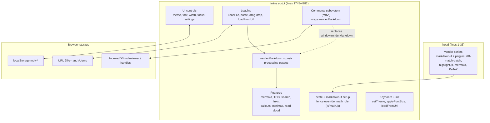

# Architecture: a code map of `markdown-viewer.html`

This is the map to read before you change the viewer. It describes where things live in the one
file, what runs when, which globals exist and who owns them, every persistence key, every keyboard
shortcut, how theming works, and how to add a new fenced-block renderer.

Related documents:

- [rendering.md](rendering.md): what each render pass does in detail.
- [commenting.md](commenting.md): the comment feature from the user's side, and the storage format.
- [read-aloud.md](read-aloud.md): the text-to-speech engine.
- [features.md](features.md): the feature list.
- [dependencies.md](dependencies.md): the vendored libraries and their versions.
- [lessons-learned.md](lessons-learned.md) and [roadmap.md](roadmap.md): known problems and planned work.
- [../README.md](../README.md) and [../CLAUDE.md](../CLAUDE.md): project entry points.

**Conventions in this document**

- Line numbers are **as of the initial import**. They will drift with every edit, so treat them as
  directions and search for the function name.
- Each behaviour statement names the function that implements it. Anything marked **(inferred)**
  was reasoned from the code without running it in a browser. Anything marked **(unverified)** has
  not been checked at all.

---


> [!NOTE]
> Since the split into files, the styles live in `css/viewer.css` and the script in the `js/*.js` files, concatenated in load order. Line numbers in this document refer to the pre-split single file and are kept for orientation: find a function by name. The script order is listed in `../CLAUDE.md`.
>
> The last script, `js/host.js`, is the desktop bridge: `window.mdvHost`. In a browser it is a no-op. In the desktop app it renders the window's document, wraps `renderMarkdown` to load relative images through the asset protocol, handles link clicks and live reload, and routes saves to the shell. See [desktop.md](desktop.md).

## 1. The shape of the program

The viewer is a single HTML file of about 4,290 lines. There is no build step, no module system and
no framework. It has four parts.

| Region | Lines (initial import) | What it holds |
|---|---|---|
| `<head>`: fonts and vendor tags | 1–33 | Google Fonts stylesheet (lines 8–11, the only network dependency, used for fonts only) and the `<script>`/`<link>` tags for everything in `vendor/` (lines 13–32) |
| `<style>` | 34–1482 | All CSS: design tokens, three themes, component styles, print and responsive rules, comment UI |
| `<body>` markup | 1484–1744 | Toolbar, panels, overlays, the layout (TOC sidebar and content), floating buttons, comment sidebar, read-aloud player |
| Inline `<script>` | 1745–4292 | All behaviour, as one classic (non-module) script of about 2,550 lines |

Because it is a classic script, every top-level `function` and `let`/`const` is visible to every
other part of the file. (Since then the script has been split into the classic scripts in `js/`,
and the markup no longer calls these globals with inline `onclick="..."` attributes: a control
names its action with `data-action`, and `js/actions.js` runs it. See `CLAUDE.md`.)



---

## 2. File layout in detail

### 2.1 `<head>` (lines 1–33)

| Lines | Content |
|---|---|
| 2 | `<html lang="en" data-theme="light">`: the theme attribute starts as `light`, and `setTheme` overwrites it at boot |
| 8–11 | Google Fonts: Inter (UI), Literata (reading), JetBrains Mono (code) |
| 14–22 | `markdown-it.min.js`, then the plugins anchor, task-lists, footnote, mark, sub, sup, deflist, abbr |
| 23 | `diff-match-patch.js` (loaded, unused since 2026-10-10: it served the removed fuzzy anchor resolver) |
| 25–26 | `github.min.css` (`id="hljs-light"`) and `github-dark.min.css` (`id="hljs-dark"`, starts `disabled`) |
| 27 | `highlight.min.js` |
| 29 | `mermaid.min.js` |
| 31–32 | `katex.min.css`, `katex.min.js` (fonts resolve to `vendor/fonts/`) |

All vendor tags are ordinary blocking tags, so every library has loaded before the inline script at
the end of `<body>` runs. [dependencies.md](dependencies.md) lists the versions.

### 2.2 `<style>` (lines 34–1482)

> [!NOTE]
> Since the visual-system change (2026-10-10), `css/viewer.css` is organised in this order: tokens
> for light, sepia and dark; reset and base (focus ring, scrollbars); toolbar; table of contents and
> layout; welcome screen; settings; reading typography; code blocks and syntax colours; tables;
> figures and lightbox; details, definition lists, footnotes and math; callouts; frontmatter
> dashboard; minimap; diagrams and the expanded view; link cards, tooltip and panel; floating UI
> (scroll buttons, search, shortcuts, read-aloud player); focus mode; motion; comments; print;
> narrow screens. The table below is the pre-split layout, kept for orientation.

| Lines | Region |
|---|---|
| 35–93 | `:root` design tokens: backgrounds, text, borders, accents, shadows, layout sizes (`--toc-width`, `--content-max-width`, `--toolbar-height`, `--tts-height`), font stacks, `--reading-size`/`--reading-lh`, radii, transitions |
| 95–130 | `[data-theme="dark"]` token overrides |
| 132–162 | `[data-theme="sepia"]` token overrides |
| 164–180 | Reset and `html`/`body` base |
| 181–284 | Toolbar, font-size control (243), theme dropdown (261) |
| 285–291 | Reading progress bar |
| 292–299 | `.layout` (reserves `--tts-height` at the bottom) |
| 300–344 | TOC sidebar |
| 345–357 | Content wrapper and `.content` width (`.expanded`, `.full-width`) |
| 358–400 | Welcome screen and drop zone |
| 401–424 | Settings panel (`.settings-toast`) |
| 425–480 | `.md-body` typography, headings, section-toggle chevrons (451), heading anchors (470) |
| 481–692 | Paragraphs, read-aloud highlight (484), links and link-type icons (491–552), link chips (553), link tooltip (597), links panel (640) |
| 693–820 | Lists, task lists, blockquotes, inline code, code blocks and `.code-header` (723), tables, `hr`, images, lightbox (784), `details`, definition lists, footnotes, `mark` |
| 821–909 | Mermaid wrapper, expand button (842), diagram fullscreen overlay (860), overlay zoom (904) |
| 910–966 | Frontmatter dashboard |
| 967–999 | Callout blocks |
| 1000–1006 | Abbreviation tooltips |
| 1007–1029 | Section minimap |
| 1030–1045 | Floating scroll buttons (FABs) |
| 1046–1084 | Search overlay |
| 1085–1103 | Keyboard-shortcuts overlay |
| 1104–1169 | Read-aloud player |
| 1170–1187 | Focus mode (`body.focus-mode` dims non-active blocks) |
| 1188–1196 | `@media print` |
| 1197–1211 | Responsive breakpoints at 900px and 600px |
| 1212–1481 | Comment UI: inline chip (1216), anchor highlight, right sidebar (1241), thread card (1283), context menu (1364), selection popover (1385), add-comment popup (1401), toast (1438), save-status pill (1458), toolbar button and badge (1469), `body.mdv-sidebar-open` layout (1475–1481) |

### 2.3 `<body>` markup (lines 1484–1744)

| Lines | Element (id) | Purpose |
|---|---|---|
| 1486–1589 | `.toolbar` | Title (`titleText`), `breadcrumb`, `readingMeta`, `mdvSaveStatus`; buttons for font size, width (`widthBtn`), TOC (`tocBtn`), fold all (`foldBtn`, hidden until a document renders), focus (`focusBtn`), search, links panel (`linksPanelBtn`, hidden), read aloud (`ttsToggleBtn`, hidden), comments (`mdvToggleBtn` + `mdvBadge`, hidden), open writable file (`mdvOpenBtn`), workspace folder (`mdvWorkspaceBtn`), theme dropdown (`themeDD`), settings, open file; hidden `<input type="file" id="fileInput">` |
| 1592 | `progressBar` | Reading progress |
| 1595–1603 | `settingsPanel` | Workspace root path input (`basePathInput`) |
| 1606–1619 | `searchOverlay` | `searchInput`, `searchResults` |
| 1622–1635 | `shortcutsOverlay` | Static list of shortcuts (incomplete, see section 7) |
| 1638–1640 | `lightbox` | `lightboxImg` |
| 1643–1657 | `diagramOverlay` | Zoom controls, `diagramTitle`, `diagramBody`, `diagramZoomContainer` |
| 1660–1665 | `linkTooltip` | Icon, text, badge, copy button |
| 1668–1674 | `linksPanel` | `linksPanelContent` |
| 1677–1701 | `.layout` | `tocSidebar` > `tocList`; `contentWrapper` > `content` > `welcomeScreen` (with `dropZone`) and `<article id="mdBody">` (the render target, hidden until a document renders) |
| 1704–1707 | `fabContainer` | Scroll-to-top (`fabUp`) and scroll-to-bottom (`fabDown`) |
| 1710–1717 | `mdvSidebar` | Comment sidebar: `mdvSidebarStatus`, `mdvThreadList` |
| 1720–1743 | `ttsPlayer` | Previous/play/next, `ttsSectionLabel`, `ttsProgressBar`/`ttsProgressFill`, `ttsSpeedBtn`, close |

### 2.4 Inline script (lines 1745–4292)

| Lines | Section |
|---|---|
| 1746–1767 | Core state and the `fontSizes` table |
| 1769–1806 | markdown-it instance, plugin registration, fence override for `mermaid` |
| 1808–1818 | `renderMath` (KaTeX pre-pass; replaced by the markdown-it rule in `js/math.js`) |
| 1820–1840 | `extractNarrations` |
| 1842–1915 | Theme, dropdown, font size, width, focus mode, settings |
| 1917–2074 | File input, drag and drop, paste, `updateUrl`, `loadFromUrl` |
| 2076–2228 | `parseFrontmatter`, `renderFrontmatterDashboard`, `renderMarkdown`, `escapeHtml` |
| 2230–2265 | `renderMermaidDiagrams` |
| 2267–2316 | Collapsible sections |
| 2318–2387 | TOC and scroll spy |
| 2389–2463 | Search |
| 2465–2476 | Image lightbox |
| 2478–2568 | Diagram overlay, its Escape handler and its wheel-zoom handler |
| 2570–2799 | Link typing, link chips, link tooltip, links panel |
| 2801–2810 | `copyCode` |
| 2812–2850 | Callout blocks |
| 2852–2894 | Section minimap |
| 2896–2943 | Abbreviation tooltips from frontmatter |
| 2945–2974 | Mermaid click-to-section |
| 2976–3275 | Read-aloud engine |
| 3277–3289 | Scroll listener (progress bar, FAB visibility) |
| 3291–3318 | Main keyboard handler |
| 3320–3325 | **Init**: `setTheme`, `applyFontSize`, `loadFromUrl` |
| 3327–3490 | `loadDemo` and its embedded demo document |
| 3492–4291 | Comment subsystem (`mdv*`): constants and state (3500–3511), parse and serialize (3513–3536), anchors (3538–3623), IndexedDB (3625–3655), file picking and saving (3657–3801), sidebar UI (3803–3951), add, reply, resolve, delete (3953–4077), right-click and selection (4079–4166), comment shortcuts (4168–4182), the `renderMarkdown` wrapper (4184–4199), restore on `load` (4201–4217), workspace folder (4219–4284), `window` exports (4286–4291) |

---

## 3. Boot sequence

Everything below runs in this order on page load.

1. **Head.** The Google Fonts stylesheet is requested. The vendor scripts execute in tag order and
   define the globals `markdownit`, `markdownItAnchor`, `markdownitTaskLists`, `markdownitFootnote`,
   `markdownitMark`, `markdownitSub`, `markdownitSup`, `markdownitDeflist`, `markdownitAbbr`,
   `diff_match_patch`, `hljs`, `mermaid` and `katex`.
2. **State (1749–1767).** `currentTheme` is read from `localStorage['mdv-theme']` (default
   `light`). `fontStep` is read from `localStorage['mdv-fontsize']` (default `0`).
3. **markdown-it (1772–1795).** `window.markdownit({ html: true, linkify: true, typographer: true, highlight })`
   is called with **no presence check**. If `vendor/markdown-it.min.js` fails to load, this line
   throws and nothing after it runs (inferred). Each plugin is registered only if its global exists
   (`if (window.markdownItAnchor) md.use(...)`, and so on).
4. **Fence override (1798–1806).** The default `fence` rule is saved as `defaultFence` and wrapped
   so that fences whose info string is exactly `mermaid` become a placeholder (see section 5).
5. **Library presence checks happen at call time, not at boot:**
   - `hljs`: `typeof hljs !== 'undefined'` inside the `highlight` callback (1777).
   - `katex`: `mdvTypeset` (`js/math.js`) shows the TeX source as code (`code.mdv-math-source`,
     delimiters included) if `katex` is undefined; `MDV_LIBRARIES` (`js/render.js`) names Math in the
     missing-library notice.
   - `mermaid`: `renderMermaidDiagrams` returns early if `mermaid` is undefined (2234).
   - `diff_match_patch`: still loaded, but no code uses it since the dead `mdvResolveAnchor` was removed
     (2026-10-10). Its `<script>` tag can be dropped.
6. **Top-level listeners** are attached as the script reaches them. Section 6 has the full list.
7. **Init (3323–3325):**
   1. `setTheme(currentTheme)` sets `data-theme`, swaps the highlight.js stylesheet and marks the
      active dropdown item. Mermaid is not re-rendered because `rawMarkdown` is still empty.
   2. `applyFontSize()` sets `--reading-size`/`--reading-lh` and the `fontLbl` label.
   3. `loadFromUrl()` (async):
      - **No `?file=`**: if `location.hash === '#demo'`, it calls `loadDemo()` synchronously.
        Otherwise it returns and the static welcome screen (markup lines 1685–1697) stays visible.
      - **`?file=` over http(s)**: it `fetch`es `file` relative to the page, then
        `localStorage['mdv-basepath'] + file`. The first response with `ok` is rendered. The fetch
        resolves after the script has finished, so this render goes through the comment wrapper.
      - **`?file=` over `file://`, or not found**: it sets the title and breadcrumb, replaces the
        welcome screen's HTML with an "Open: <name>" prompt (on `file://` this includes a
        `python3 -m http.server` hint), and binds drag-over styling to the new `dropZone2`.
8. **Comment subsystem (`js/comments.js`)** is evaluated *after* init. It reads
   `localStorage['mdv-author-name']` (default `You`, inside a `try`), registers the markdown-it core rule
   `mdv_blocks` and wraps the fence renderer (block numbers and anchor ids, see
   [commenting.md](commenting.md#resolving-an-anchor)), attaches the document `mouseup`, comment `keydown` and
   `beforeunload` listeners, registers a `window` `load` listener, **replaces `window.renderMarkdown` with a
   hook**, wires the right-click menu on `#mdBody`, and exports six functions on `window`. If a document was
   already rendered (the `#demo` page, step 7), it renders it once more through the hook, so the demo has
   comments too.
9. **`js/reading-place.js`, `js/live-reload.js`, `js/live-notes.js`, `js/history.js` and `js/document-links.js`** define the reader's
   place and register their hooks on the load seam (`mdvOnDocumentOpening`, `mdvOnDocumentOpened`,
   `mdvOnDocumentDrawn`), the `history-back`/`history-forward`/`live-reload`/`live-dismiss`/`live-review` actions,
   `popstate` and `hashchange` listeners, a `click` listener for the `#` permalinks, a capture-phase `click` listener
   on `window` (links that open in the viewer) and a `visibilitychange` listener. On `DOMContentLoaded`, `files.js`
   wraps the final `renderMarkdown` once more (`mdvTrackRenders`, so every render of a document is reported; the
   desktop bridge wraps it in turn), and `history.js` and `live-notes.js` register `Alt+←`/`Alt+→` and `Alt+R` with
   `mdvRegisterShortcut`, which `app.js` defines.
10. **`window` `load` event.** Skipped entirely in the desktop app. The handler reads the IndexedDB key
   `workspace`; if its `read` permission is already `granted`, it becomes `mdvWorkspaceDir`. It then reads
   `current` and opens it with `mdvOpenWithHandle(handle, { prompt: false })` (never a permission prompt
   outside a gesture: without write permission the file opens read-only), **unless** the URL has a `?file=`
   link or `#demo`, or a document is already shown or gets opened while the restore runs. A `?file=` link
   therefore always wins over the restore (on `file://`, where a link cannot load, the remembered file of
   that very name stands in).

---

## 4. Global state and owners

### 4.1 Core (lines 1749–1767)

| Variable | Written by | Read by |
|---|---|---|
| `rawMarkdown` | `readFile`, paste listener, `loadFromUrl`, `loadDemo`, `mdvOpenWithHandle`, `mdvReloadFromDisk`, and `mdvCommit` (every comment change writes the serialized comments into it) | `setTheme` (as a "document loaded" flag), `mdvDocumentChanging` (a loader replaced it but has not rendered yet), `mdvTryWorkspaceMatch`, `mdvOpenOrSetSaveLocation`, the startup restore, Ctrl/Cmd+S handler. Comment changes and saves start from `mdvDocText`, the document on screen |
| `currentTheme` | `setTheme` | `renderMermaidDiagrams`, the init call `setTheme(currentTheme)` |
| `fontStep` | `changeFontSize` (clamped to −2..2) | `applyFontSize` |
| `fontSizes` (const) | — | `applyFontSize` (index `2 + fontStep`) |
| `tocVisible` | `toggleToc` (desktop widths only) | `toggleToc` |
| `allCollapsed` | `toggleAllSections`, reset in `renderMarkdown` | `toggleAllSections` |
| `isExpanded` | `toggleWidth` | `toggleWidth` |
| `isFocusMode` | `toggleFocus` | `toggleFocus` |
| `searchIndex` | `buildSearchIndex` | `handleSearch` |
| `searchFocusIdx` | `openSearch`, `handleSearch`, `handleSearchKeys` | `handleSearchKeys` |
| `narrationMap` | reset to `{}` by `extractNarrations` | nobody (dead) |
| `currentFileName` | `readFile`, `loadFromUrl`, `mdvOpenWithHandle`, `mdvReloadFromDisk` (the paste path does **not** update it) | `mdvBeginDocument` and `mdvDownloadName`, only as a fallback: the comment code names files after the title each document was rendered with (`mdvDocName`) |

### 4.2 Rendering and feature modules

| Variable | Lines | Owner |
|---|---|---|
| `md` | 1772 | The markdown-it instance, used by `renderMarkdown` (`md.render`), the `highlight` callback and the fence override (`md.utils.escapeHtml`) |
| `defaultFence` | 1798 | The fence override |
| `chevronSvg` | 2270 | `addSectionToggles` |
| `diagramZoomLevel`, `diagramFitMode` | 2481–2482 | The expanded view's scale in percent (shown in `#diagramZoomLabel`) and whether it follows "fit to screen". Written by `mdvApplyView` and the fit, zoom and pan paths in `js/diagram-overlay.js` |
| `mdvView` | `js/diagram-overlay.js` | The expanded view's state: the diagram shown, scale, translation, natural size, active pointers and gesture, animation frame, the element to give focus back to |
| `mdvMermaidQueue`, `mdvMermaidGeneration`, `mdvMermaidSeq` | `js/mermaid.js` | Render passes run one after another; a newer request stops an older pass; render ids are never reused |
| `MDV_DIAGRAM_TITLES`, `MDV_DIAGRAM_TOKENS` | `js/mermaid.js` | Mermaid's `diagramType` → title; palette name → `--diagram-*` custom property |
| `mdvMinimap` | `js/enhancements.js` | The section rail of the current document (its element and segments) and its `ResizeObserver`, disconnected before the next render builds a new one. Which segment is current is not kept here: the scroll spy (`mdvSpy`) marks the rail |
| `mdvTableResize` | `js/enhancements.js` | One `ResizeObserver` over the document's tables (scroll cues), disconnected on the next render |
| `mdvDiagramFontLate` | `js/mermaid.js` | A wait for the Inter web font has timed out and the redraw on its arrival is pending, so later passes do not wait again |
| `LINK_TYPES` | 2573 | `enhanceLinks`, `showLinkTooltip`, `buildLinksPanel` |
| `tooltipHideTimer` | 2675 | `showLinkTooltip`, `hideLinkTooltip`, tooltip `mouseenter` |
| `CALLOUT_TYPES` | 2817 | `transformCalloutBlocks` (NOTE, TIP, IMPORTANT, WARNING, CAUTION, TLDR, DECISION, COST) |
| `MDV_NOT_TEXT_TAGS`, `MDV_NOT_TEXT_CLASSES` | `navigation.js` | `mdvExcludedFromText`: what is not the author's words (the viewer's controls, a link card's icon, address and badge, `aria-hidden` copies, MathML annotations, `<style>`/`<script>`/`<template>` matched by `localName` so SVG's count too) |
| `mdvSpy` | `navigation.js` | The scroll spy: the render's headings, visible headings, TOC links by id, the section rail and its segments with their `h2`s (`rail`), the rail's name before the first heading (`railStart`), the visible-heading list the rail was last marked from (`railFrom`), the active heading, the breadcrumb's home text, the pending animation frame. Set by `setupScrollSpy`, read by `mdvScrollSpyUpdate`, `mdvSetActiveHeading` and `mdvMarkRail` |
| `mdvModal` | `navigation.js` | The open dialog `{ el, returnTo, tabStart, inerted, hidden }`, or `null`. `mdvOpenModal`, `mdvCloseModal`, the Tab trap, the focus guard, the shortcut handler |
| `mdvNarrow` | `navigation.js` | `matchMedia('(max-width: 900px)')`, the stylesheet's breakpoint: `toggleToc` and `mdvSyncTocInert` |
| `mdvSearchStale` | `navigation.js` | The search index is out of date; `mdvSearchIndex` rebuilds it on the next search |
| `MDV_SHORTCUTS`, `MDV_IS_MAC` | `app.js` | The shortcut table that drives the key handler and the `?` sheet. Other scripts add rows with `mdvRegisterShortcut` |
| `mdvShown`, `mdvPendingOpen`, `mdvOpenSeq`, `mdvDocumentHooks` | `files.js` | The load seam: the record of the document on screen (`mdvShownDocument()`), the newest open `mdvOpenDocument` has started, the count of opens (an older handle open gives up when it moved on), and the opening/opened/drawn hooks |
| `mdvHistory` | `history.js` | Back/Forward: document records by id (the document, the reader's place in it, the link they left by, unsaved comment changes), the tab's positions mapped to document ids (in-document places repeat an id), the tab's position now, the id of the document on screen |
| `mdvLive` | `live-reload.js` | Live reload: the timer, the look on its way (with its timeout and abort), the source last looked at and its version, the version waiting for a second look and how many looks in a row saw another one, whether the file is gone, the window's own file (desktop), the newer version waiting for the reader and why (the question, Not now, a comment box open) |
| `mdvWrittenHref` | `document-links.js` | Links whose `href` now holds the viewer's own address (over http), mapped to the `href` the document wrote (`mdvLinkHref(a)`) |
| `ttsSections`, `ttsStale`, `ttsRebuildQueued` | `read-aloud.js` | Built by `ttsBuildSections` (right after a render, as a microtask, only while the player is in use; otherwise when it opens), read by all `tts*` functions |
| `ttsCurrentIdx`, `ttsIsPlaying`, `ttsUtterance`, `ttsFinished` | `read-aloud.js` | `speakSection`, `speakNextChunk`, `ttsPlay`, `ttsPause`, `ttsStop`, `ttsGoTo`, `ttsSeekClick`, `ttsReconcile` |
| `ttsRate`, `ttsRates`, `ttsRateIdx` | `read-aloud.js` | `ttsCycleSpeed`. The rate is saved in `localStorage` (`mdv-tts-rate`). |
| `ttsGen`, `ttsPausedGen`, `ttsErrors` | `read-aloud.js` | The generation number every cancel bumps (stale utterance events are ignored), the generation a desktop pause may resume, consecutive errors |
| `ttsKeepAliveTimer`, `isAndroid`, `ttsSupported` | `read-aloud.js` | `ttsStartKeepAlive`, `ttsStopKeepAlive`, `ttsPause`; `ttsSupported` disables the player where speech is missing |
| `ttsChunks`, `ttsChunkIdx`, `ttsChunksFor` | `read-aloud.js` | `speakSection`, `speakNextChunk`, `ttsPlay` |
| `ttsReturnFocus` | `read-aloud.js` | `ttsToggle` records it, `ttsStop` gives the focus back to it |

### 4.3 Comment subsystem (`js/comments.js`)

| Variable | Owner |
|---|---|
| `MDV_VERSION` (=1), `MDV_GENERATOR`, `MDV_RE_ANCHOR`, `MDV_RE_BLOCK_START`, `MDV_RE_BLOCK_HEAD`, `MDV_RE_BLOCK_CLOSE`, `MDV_RE_BLOCK_OPEN`, `MDV_RE_BLOCK_END` | `mdvLocateBlock`, `mdvLocateBlockAtEnd`, `mdvReadPayload`, `mdvParseFile`, `mdvSerialize`, `mdvMarkerIds`, `mdvRemoveMarkers` |
| `mdvParseCache` | The last markdown-it parse (`mdvParseMarkdown`): locating the block, its markers and an insertion point ask about the same text |
| `mdvComments` | Set by the `renderMarkdown` hook from `mdvParseFile`, and by `mdvCommit`. Every change (`mdvAddComment`, `mdvPostReply`, `mdvResolveThread`, `mdvDeleteThread`) builds a new list and commits it together with the serialized source, so a later re-render reads back the same comments. |
| `mdvFileHandle` | The handle the current document was read from, or `null`. Set by `readFile` (workspace match or `null`), the paste listener and `loadFromUrl` (`null`), `mdvOpenWithHandle`, `mdvLinkOpenedFile`, `mdvSaveAsNewFile`, `mdvPickWorkspace`; cleared by `mdvBeginDocument` when its recorded version is not the document being rendered. Read by `mdvCurrentTarget`, `mdvWriteDocument`, `mdvSaveFile`, `mdvShowAddPopup`, `mdvOpenOrSetSaveLocation`, `mdvEncodingLock`. |
| `mdvBases` (WeakMap) | Per handle, the version the viewer read or last wrote: `{text, gen, notUtf8}`, or `{overwrite: true, gen}` for a new file picked in the Save dialog. Written by `mdvOpenWithHandle`, `mdvMatchInFolder`, `mdvLinkOpenedFile` (the version that was opened), `mdvSaveAsNewFile`, `mdvBeginDocument` (a handle linked without one, and a new generation for every load) and `mdvWriteHandle` (after a write, same generation). Read by `mdvWriteHandle` (the conflict and generation checks), `mdvCurrentTarget`, `mdvBeginDocument` and `mdvEncodingLock`. |
| `mdvGen` | Counts generations: each version of a file the viewer takes as its base by reading it. A queued save carries one and is refused (`stale`) once its file was read again. |
| `mdvDesktopBase` | Desktop: `{path, text, mtimeMs, gen}`, the window's file as far as the document on screen goes. Set by `mdvBeginDocument` (mtime unchecked) and `mdvReloadFromDisk`, updated by `mdvWriteDesktop` after a write. |
| `mdvDiscarded` | `{key, loadSeq}` of comment changes the reader discarded with "Reload from disk"; their saves end quietly. |
| `mdvWorkspaceDir` | Set by the `load` restore and `mdvPickWorkspace`. Read by `mdvTryWorkspaceMatch`. |
| `mdvDirty` | True from a comment change until that version is written. Read by `mdvBeginDocument` and `beforeunload`. |
| `mdvLoadSeq`, `mdvDocVersion` | Count document loads and committed changes. A queued write, the restore and a late open use them to know their document is still the one shown. |
| `mdvDocName`, `mdvDocTitle`, `mdvDocText`, `mdvLoadedText` | The current document's name and title as rendered, its last committed text, and its text as opened. |
| `mdvLockReason`, `mdvLockKind` | Why comments are read-only for the current document, or `null`, and whether its comment block cannot be read (`block`) or the file is not UTF-8 text (`encoding`). |
| `mdvOwnRender` | True while `mdvRerender` re-renders the current document itself. |
| `mdvWriteChain`, `mdvNewestJob`, `mdvQueuedVersion`, `mdvWritesQueued` | The write queue (`mdvEnqueueWrite`). |
| `mdvWriteLock` | Serializes `mdvWriteDocument` itself, so no two writes overlap whoever calls it (the queue, or the reader's Overwrite). |
| `mdvNotices` | Conflicts, failed saves and unsaved changes of closed documents, shown at the top of the sidebar. Each records the file (`key`), the document load and version its text holds, and for a conflict the version found on disk (`disk`). |
| `mdvStatusTimer` | Clears the "Saved ✓" status after 3 s. |
| `mdvAuthorName` | Read once from `localStorage['mdv-author-name']`, used by `mdvAddComment` and `mdvPostReply` |
| `MDV_SHA256_K` | `mdvSha256Hex` |
| `MDV_DB`, `MDV_STORE` | `mdvOpenDb`, `mdvPutHandle`, `mdvGetHandle` |
| `MDV_BLOCK_TAGS` | `mdvFindBlock` |

### 4.4 State hung on objects

| Location | Written by | Read by |
|---|---|---|
| `window._frontmatter` | `renderMarkdown` | nobody |
| `window._narrations` | `renderMarkdown` (from `extractNarrations`) | nobody (read-aloud reads narration from the DOM) |
| `window.__mdvMouseupWired` | top-level guard (4105) | same guard |
| `mdBody.__mdvWired` | `mdvAttachContextMenu` (called when `comments.js` loads) | same function. `#mdBody` survives re-renders because only its `innerHTML` is replaced, so the context menu is wired once. |
| `data-mdv-block`, `data-mdv-anchor` attributes on top-level blocks in `#mdBody` | the markdown-it core rule `mdvAnnotateBlocks` at render time; `mdvAddComment` and `mdvDeleteThread` update `data-mdv-anchor` in place | `mdvBuildAnchorMap`, `mdvLocateInsertion` |
| `searchResults._matches` | `handleSearch` | `goSearch` |
| `linkTooltip.dataset.href` | `showLinkTooltip` | `copyLinkUrl` |
| CSS custom properties on `<html>`: `--reading-size`, `--reading-lh`, `--tts-height` | `applyFontSize`, `ttsToggle`, `ttsStop` | CSS |

---

## 5. The render pipeline (overview)

Every render goes through one entry point, `renderMarkdown(source, title)`. Every loader calls it:
`readFile`, the paste listener, `loadFromUrl`, `loadDemo`, `mdvOpenWithHandle`, `mdvAddComment`
and `mdvDeleteThread`. After the comment subsystem loads, the name resolves to the **wrapper**
(4187). Top-level function declarations in a classic script are properties of `window`, so
`window.renderMarkdown = ...` also changes what a bare `renderMarkdown(...)` call reaches.

```mermaid
sequenceDiagram
    participant L as Loader
    participant W as renderMarkdown wrapper
    participant R as original renderMarkdown
    participant MI as markdown-it
    L->>W: renderMarkdown(source, title)
    W->>W: mdvParseFile(source) sets mdvComments
    W->>R: orig(source, title)
    R->>R: parseFrontmatter, extractNarrations, renderFrontmatterDashboard
    R->>MI: md.render(body)
    MI-->>R: HTML (math typeset by KaTeX; mermaid fences become placeholders)
    R->>R: mdvSanitize(dashboard + HTML) replaces #mdBody's content, then the post-processing passes
    W->>W: after 50 ms: mdvAttachContextMenu, mdvRenderSidebar
```

Inside the original `renderMarkdown` (2169–2226), in this exact order:

1. `parseFrontmatter(source)` strips a leading `---` YAML block with a small hand-written parser
   and stores the result in `window._frontmatter`.
2. `extractNarrations(source)` collects `<!-- narrate: ... -->` comments into `window._narrations`.
   The source itself is not changed.
3. `md.render(body)` parses the markdown. Math is one of its rules (`js/math.js`: `mdvMathInline`,
   `mdvMathBlock`), and `mdvTypeset` typesets each formula with KaTeX during the parse; code spans and
   code blocks are tokenized first, so they never hold math.
4. `mdvSanitize(renderFrontmatterDashboard(meta) + html)` (DOMPurify). Steps 1–4 are
   `mdvBuildContent`: if one throws, it builds the error and the document's text instead
   (`mdvRenderErrorHtml`). Either result replaces `#mdBody`'s content.
5. Chrome updates: `#mdBody` is shown, the welcome screen hidden, and the FABs, fold button and
   read-aloud button revealed. The title and breadcrumb are set, and so are reading stats (words
   divided by 230, at least 1 minute).
6. Post-processing passes, each in its own `try/catch` so one failure does not stop the rest:
   1. `transformCalloutBlocks`
   2. `addSectionToggles`
   3. `buildToc`
   4. `buildSectionMinimap`
   5. `buildSearchIndex`
   6. `buildTtsSections`
   7. `renderMermaidDiagrams`. This is **async and not awaited**: the passes after it run before
      the SVGs exist, and its rejections are not caught by the `try`.
   8. `setupScrollSpy`
   9. `setupImageLightbox`
   10. `enhanceLinks` (calls `buildLinksPanel`)
   11. `applyAbbreviationTooltips(meta)`
   12. `setupMermaidClickToSection`
7. Shows `linksPanelBtn`, resets `allCollapsed = false`, scrolls to the top.

The wrapper then calls `mdvAttachContextMenu()` and `mdvRenderSidebar()` in a 50 ms `setTimeout`.
`mdvRenderSidebar` also calls `mdvRenderChips`, updates the badge and shows the comments button.

[rendering.md](rendering.md) covers what each pass does to the DOM, the order constraints between
passes, and the code-block markup.

---

## 6. Event wiring

### 6.1 Listeners attached at the top level

| Target and event | Lines | Handler behaviour |
|---|---|---|
| `document` `click` | 1865 | Closes dropdowns unless the click is inside `.dropdown-wrap` |
| `document.body` `dragenter`/`dragover` | 1966 | `preventDefault` so the drop is allowed |
| `#dropZone` `dragenter`/`dragover`/`dragleave`/`drop` | 1967–1970 | Toggles `.drag-over` |
| `document.body` `drop` | 1972 | Reads the first file if its name matches `.md`, `.markdown`, `.mdx`, `.txt` or `.text`, via `readFile` |
| `document` `paste` | 1979 | Ignored while the search overlay is open or when the paste target is an `input`, `textarea`, `select` or content-editable element. Otherwise pasted text longer than 10 characters becomes the document: `mdvFileHandle = null`, then `renderMarkdown(text, 'Pasted Content')` and `updateUrl('pasted')` |
| `#tocList` `click` | `navigation.js` | One delegated listener for every outline link: unfold, scroll to and focus the heading, close the mobile outline |
| `mdvNarrow` `change` | `navigation.js` | The window crossed 900 px: `mdvSyncTocInert` (a hidden outline is inert) |
| `window` `scroll` (passive), `window` `resize` (passive) | `navigation.js` | The scroll spy: schedules `mdvScrollSpyUpdate` for the next animation frame |
| `#mdBody` `toggle` (capture) | `navigation.js` | A `<details>` opened or closed: the scroll spy recomputes which headings can be seen |
| `document` `keydown` (capture) | `navigation.js` | While a dialog is open, Tab and Shift+Tab cycle inside it |
| `document` `focusin` | `navigation.js` | The focus guard: focus that lands behind the open dialog goes back into it |
| `document` `click`, `change`, `input`, `keydown` (capture) | `actions.js`, one per event type an action uses | `mdvDispatchAction` runs the `data-action` of the nearest control. Search results carry `data-action="go-search"`, so `#searchResults` has no listener of its own |
| `#mdBody` `click`, `keydown` | `navigation.js` | Delegated: a click on, or Enter/Space on a focused, `img[role=button]` opens the lightbox |
| `#mdBody` `click` | `links.js` | Delegated: an in-document link (`href="#…"`) goes to its target (`mdvLinkTarget`, then `mdvGoTo`) and adds a history entry with the fragment; a click with a modifier key and the `#` permalink are left to the browser |
| `#ttsProgressBar` `keydown` | `read-aloud.js` | `ttsSliderKeys`: arrows, Page Up/Down, Home, End move between sections |
| `document` `keydown` (capture phase) | `js/diagram-overlay.js` | While the expanded view is open: Esc closes it, `+` `=` `-` `_` zoom, `0` fits, `1` shows actual size, the arrow keys pan, Tab stays inside the dialog. These keys do not reach the page's other shortcuts |
| `#diagramBody` `wheel` (not passive), `pointerdown`/`move`/`up`/`cancel` | `js/diagram-overlay.js`, attached on first open | Wheel and ctrl+wheel (trackpad pinch) zoom around the pointer; one pointer pans; two pointers pinch-zoom; a click without a drag on a linked node goes to its section |
| `#linkTooltip` `mouseenter`/`mouseleave` | 2717–2718 | Keeps the tooltip open while it is hovered |
| `window` `beforeunload` | 3227 | Stops the keep-alive timer and cancels speech |
| `window` `scroll` (passive) | 3280 | Progress bar width, FAB visibility |
| `document` `keydown` | `app.js` | Main shortcut handler, driven by `MDV_SHORTCUTS` (section 7). While a dialog is open it calls `stopImmediatePropagation` for the table's shortcuts, so the comments listener below does not see them |
| `document` `mouseup` | 4107 | `mdvHandleSelection` (shows the "Comment" popover), unless the click is inside comment UI |
| `document` `keydown` | 4169 | Comment shortcuts (Ctrl/Cmd+Shift+C, Ctrl/Cmd+S) |
| `window` `load` | 4202 | Restores the workspace and the last file handle from IndexedDB |
| `window` `click` (capture) | `document-links.js` | A relative link to a Markdown file in the document or the links panel opens in the viewer (folder, desktop bridge or `fetch`); Cmd/Ctrl-click over http opens the viewer for it in a new tab. Runs before `js/host.js`, which would open a new window |
| `window` `popstate`, `hashchange` | `history.js` | Back/Forward to a place of another document reads it again and shows it through the seam, at the reader's place; a place of the same document (an in-document link, a `#` permalink) is the browser's, and is named as one of this document's |
| `document` `click` | `history.js` | A click on a heading's `#` permalink: the place the browser is about to make is named when it arrives |
| `document` `visibilitychange` | `live-reload.js` | Hidden: live reload stops looking. Shown: it looks at once |
| `MutationObserver` on `document.body` (`childList`) | `live-reload.js`, only while a newer version waits | The add-comment box opening (the question waits for it) and closing (the waiting version is shown or asked about) |

### 6.2 Listeners attached per render or per interaction

| Attached in | Element and event | Behaviour |
|---|---|---|
| `renderMermaidDiagrams` (`mdvMakeDiagramExpandable`, once per wrapper) | expand button `click`, wrapper `click` | `openDiagramOverlay(wrapper)`, except on a node that links to a section |
| `addSectionToggles` | chevron `click` (its `onclick` property, set from script) | `toggleSection` |
| `buildToc` | nothing (the `#tocList` listener is delegated) | |
| `setupScrollSpy` | nothing: it hands the page-lifetime scroll listener this render's headings, outline links and section-rail segments | Active outline link, breadcrumb text, and the rail: current and already-read segments, the current section's name and position (`mdvMarkRail`) |
| `buildSectionMinimap` | segment `click`; a `ResizeObserver` on the rail (the previous render's is disconnected) | Go to the section as an outline link does (`mdvGoTo`); label or track mode |
| `setupImageLightbox` | nothing: it gives each image outside a link `tabindex="0"`, `role="button"` and a name; `#mdBody` listeners are delegated | Opens the lightbox |
| `enhanceLinks` | each link `mouseenter`/`mouseleave` | `showLinkTooltip` / `hideLinkTooltip` |
| `buildLinksPanel` | anchor-type items `click` | Closes the panel and goes to the target (`mdvLinkTarget`, `mdvGoTo`) |
| `mdvLinkDiagramNodes` (from `renderMermaidDiagrams` after each diagram is drawn, and `setupMermaidClickToSection`) | wrapper `click` and `keydown`, delegated to `[data-mdv-section]` nodes | Goes to the heading as an outline link does (`mdvGoTo`: unfold, open `<details>`, scroll, focus), then flashes it (`mdvJumpToSection`) |
| `loadFromUrl` | `#dropZone2` drag events | `.drag-over` styling only (the body `drop` listener does the read) |
| `mdvAttachContextMenu` | `#mdBody` `contextmenu` (once) | Custom "Add comment" menu. Shift+right-click keeps the native menu. |
| `mdvShowContextMenu` | menu button `click` (`onclick` property), a one-shot `document` `mousedown` named `close` | Opens the add popup, or dismisses the menu |
| `mdvHandleSelection` | popover `mousedown` (prevents deselect), `click` | Opens the add popup for the selection |
| `mdvShowAddPopup` | cancel/save `click` (`onclick` properties), textarea `keydown` | Saves or cancels the comment |
| `mdvRenderSidebar` | reply/resolve/delete `click` (`onclick` properties), reply textarea `keydown` | Thread actions |
| `mdvRenderChips` | chip `click` (`onclick` property) | `mdvFocusThread` |

`setupScrollSpy` used to create an `IntersectionObserver` on every heading on every render and never
disconnect it. It creates nothing now: one scroll listener, attached when the script loads, finds the
current heading by binary search, and the same decision marks the section rail (`mdvMarkRail`): the
current segment, the segments already read, and the name and position the track shows. Nothing else
writes the rail's state. `buildSectionMinimap` creates no `IntersectionObserver`; it disconnects the
previous render's `ResizeObserver` before creating its own. Until 2026-10-10 the rail also had its own
page-lifetime `scroll` and `resize` listeners (`mdvUpdateMinimap`) with their own rule, the last `h2`
above the reading line by `getClientRects()`, and the two disagreed at the bottom of a page and past a
closed `<details>`; that writer was deleted (`reading-aids.spec.mjs` checks that the rail and the
outline agree in both places).

The `onclick` entries above are DOM properties set from script, not attributes: the Content Security
Policy refuses inline handlers, not handlers a script assigns.

### 6.3 No inline handlers: `data-action` and `js/actions.js`

The markup has no inline handler: no `on*=` attribute and no `javascript:` URL, which the Content
Security Policy (`script-src 'self' file:`) would refuse. Each control names what it does with
`data-action="<name>"` and an optional `data-arg`, and `js/actions.js` runs it: `mdvRegisterActions`
keeps a registry of named actions, each mapping event types to a handler `(element, arg, event)`, and
adds one capture-phase listener on `document` per event type an action uses; `mdvDispatchAction` runs
the action of the nearest `[data-action]` element.

The markup's actions: `font-size`, `toggle-width`, `toggle-toc`, `toggle-all-sections`,
`toggle-focus`, `open-search`, `toggle-links-panel`, `tts-toggle`, `toggle-comments`,
`open-writable`, `pick-workspace`, `toggle-dropdown`, `set-theme`, `toggle-settings`,
`save-base-path`, `open-file`, `file-chosen` (`change`), `browse-file`, `search` (`input` and
`keydown`), `close-search` and `close-shortcuts` (only on a click on the backdrop itself),
`close-lightbox`, `diagram-zoom`, `diagram-fit`, `close-diagram`, `copy-link`, `scroll-top`,
`scroll-bottom`, `tts-prev`, `tts-play-pause`, `tts-next`, `tts-seek`, `tts-speed` and `tts-stop`.
Controls built by script carry actions too: each search result (`go-search`), the Copy button of each
code block (`copy-code`, set by `mdvWireCodeBlocks` in `js/render.js`), the dismiss button of a
missing-library notice (`dismiss-notice`), and the expanded view's "1:1" button
(`diagram-actual-size`, registered by `js/diagram-overlay.js`).

Markup made from document data sits in `[data-mdv-document]` containers (`#mdBody`, the diagram
overlay's `#diagramZoomContainer`, the comment sidebar's `#mdvThreadList`). An action inside one runs
only on an element the viewer marked as its own with `mdvMarkOwnControl` (today the Copy buttons), and
the sanitizer drops `data-action` and `data-arg` from document HTML, so a document cannot press the
viewer's buttons (`security.spec.mjs`).

Renaming a function a control calls means updating its entry in the registry in `js/actions.js` (or
in the script that registers it), not the markup.

---

## 7. Keyboard shortcuts (complete)

The table comes from every `keydown` site: the handlers in `diagram-overlay.js`, `app.js` and
`comments.js`, the Tab trap in `navigation.js`, the `onkeydown` on `#searchInput`, the slider keys on
`#ttsProgressBar`, the lightbox keys on `#mdBody`, and the per-element textarea listeners in
`mdvRenderSidebar` and `mdvShowAddPopup`. "Mod" means Ctrl or Cmd (`e.ctrlKey || e.metaKey`).

The `app.js` shortcuts come from the table `MDV_SHORTCUTS`. `mdvShortcutMatches` compares the key
case-insensitively (`mdvTypedKey`), so Caps Lock and Shift do not change it; requires Shift exactly for
letter shortcuts and named keys and ignores it for punctuation; matches with Alt held only a row that asks for
Alt (so AltGr never triggers one); a `run` that returns `false` leaves the key to the browser; falls back to the
physical key (`e.code`) on non-Latin layouts and for `\` and `.`. `mdvIsTextEntry` decides what counts as
typing (a text `input`, `textarea`, `select` or editable content, not a checkbox or a button), and key
events of an input method that is composing are ignored. While a dialog is open (one of ours, or the
expanded diagram: `mdvFrontDialog`) only `Escape` and that dialog's own toggle are handled; the table's
other shortcuts are prevented and stopped, except Save (`inDialog`), and a `?` typed into a text field
stays text.

| Keys | Where it works | Action | Implemented in |
|---|---|---|---|
| Mod+K | Not while typing; inside search it closes it | Toggle search | `app.js`: `openSearch` / `closeSearch` |
| Mod+B | Not while typing | Toggle TOC (slide-in panel at widths of 900px or less) | `app.js`: `toggleToc` |
| Mod+`\` | Same | Toggle full page width | `app.js`: `toggleWidth` |
| Mod+`.` | Same | Toggle focus mode | `app.js`: `toggleFocus` |
| Mod+Shift+F | Same | Fold or unfold all sections | `app.js`: `toggleAllSections` |
| Mod+Shift+R | Same | Show or close the read-aloud player | `app.js`: `ttsToggle` |
| Mod+O | Same | Open the file picker (`#fileInput`) | `app.js` |
| `?` (no Mod) | Same; inside the shortcuts sheet it closes it | Toggle the shortcuts sheet | `app.js`: `toggleShortcuts` |
| Alt+← / Alt+→ | Not while typing; with nowhere to go, the browser's | Back / forward to the previous / next document (over the places inside the one on screen) | `history.js`: `mdvHistoryBack`, `mdvHistoryForward`, registered with `mdvRegisterShortcut` |
| Alt+R | Not while typing; only while a newer version of the document waits | Reload it (the question's Reload), or ask again (the "Newer version on disk" mark) | `live-notes.js`, registered with `mdvRegisterShortcut` |
| Escape | Anywhere | Close the open dialog and give the focus back; with none open, close the slide-in TOC | `app.js`: `mdvCloseModal` |
| Tab / Shift+Tab | Inside an open dialog | Cycle inside it; in the diagram overlay, through its buttons and then the nodes that link to a section | `navigation.js` Tab trap; `js/diagram-overlay.js` for the diagram overlay |
| Enter / Space | A focused document image | Open the lightbox | `navigation.js`: `openLightbox` |
| Arrows, Page Up/Down, Home, End | The read-aloud progress slider | Move between sections | `read-aloud.js`: `ttsSliderKeys` |
| Escape | Anywhere, while the diagram overlay is open | Close the diagram overlay | `js/diagram-overlay.js`: `closeDiagramOverlay` |
| `+` (`=`) / `-` (`_`) | While the diagram overlay is open | Zoom in / out by 25% around the centre | `js/diagram-overlay.js`: `diagramZoom` |
| `0` / `1` | While the diagram overlay is open | Fit to screen / actual size | `js/diagram-overlay.js`: `mdvDiagramFit`, `mdvDiagramActualSize` |
| Arrow keys (Shift: further) | While the diagram overlay is open | Pan | `js/diagram-overlay.js` |
| Enter or Space | On a focused diagram node that links to a section | Go to that section | `js/enhancements.js`: `mdvJumpToSection` |
| Mod+Shift+C | **Anywhere, including inputs** | Toggle the comment sidebar | 4169: `mdvToggleSidebar` |
| Mod+S (also Mod+Shift+S) | Anywhere, once a document is loaded | Save now, prompting for a location if needed | 4169: `mdvSaveFile({ allowPrompt: true })` |
| ArrowDown / ArrowUp | Search input | Move the selected result (wraps around) | `handleSearchKeys` |
| Enter | Search input | Jump to the selected result, or the first one | `handleSearchKeys` → `goSearch` |
| Escape | Search input | Close search | `handleSearchKeys` |
| Mod+Enter | Reply textarea in a thread card | Post the reply | `mdvRenderSidebar` → `mdvPostReply` |
| Mod+Enter | Add-comment popup textarea | Save the comment | `mdvShowAddPopup` (clicks `.mdv-add-save`) |
| Escape | Add-comment popup textarea | Cancel the popup | `mdvShowAddPopup` |

Mouse gestures: in the diagram overlay, drag pans and the wheel (or a trackpad or touch pinch) zooms around the pointer (`mdvZoomAt`). Right-click on a block in
`#mdBody` opens the comment menu (`mdvAttachContextMenu`), and Shift+right-click keeps the browser
menu. Selecting 3 or more characters inside `#mdBody` shows the "Comment" popover
(`mdvHandleSelection`).

Notes:

- The help sheet is drawn from `MDV_SHORTCUTS` (`mdvRenderShortcutSheet`), so it lists every `app.js`
  shortcut plus Mod+Shift+C, Mod+S and Escape, in the platform's key names. The static rows in the
  markup are replaced the first time it opens.
- Some browsers reserve Ctrl+Shift+R (hard reload) and Ctrl+Shift+C (inspect element). Whether the
  page receives those key events is **(unverified)**.

---

## 8. Persistence: every key

### 8.1 `localStorage`

| Key | Value | Read by | Written by |
|---|---|---|---|
| `mdv-theme` | `light` / `sepia` / `dark` | top-level state init (1750) | `setTheme` |
| `mdv-fontsize` | integer −2..2 | top-level state init (1751) | `changeFontSize` |
| `mdv-basepath` | string, a trailing `/` is added | `toggleSettings` (fills the input), `loadFromUrl` (second fetch candidate) | `saveBasePath` |
| `mdv-author-name` | string, default `You` | comment state init (3510) | **nothing**: no UI or code path writes it |
| `mdv-tts-rate` | `0.75` … `2`; anything else means 1x | read-aloud state init (`mdvStoredRate`) | `ttsCycleSpeed` |

Apart from `mdv-tts-rate`, none of these accesses is wrapped in `try/catch`. If storage throws, for
example when site data is blocked, the reads at lines 1750–1751 stop the whole script (inferred).

### 8.2 IndexedDB

| Database | Version | Object store | Keys | Value |
|---|---|---|---|---|
| `mdv-viewer` (`MDV_DB`) | 1 | `handles` (`MDV_STORE`, out-of-line keys) | `current` | `FileSystemFileHandle` of the last writable file |
| | | | `workspace` | `FileSystemDirectoryHandle` of the workspace folder |

- Opened by `mdvOpenDb`, which creates the store in `onupgradeneeded`.
- `mdvPutHandle(key, handle)` writes. Callers: `readFile` (`current`, on a workspace match),
  `mdvOpenWithHandle` (`current`), `mdvEnsureWritableHandle` (`current`), `mdvPickWorkspace`
  (`workspace`, and `current` if the loaded file is found in the folder).
- `mdvGetHandle(key)` reads, and returns `null` on any error. Its only caller is the `window` `load`
  handler, for `workspace` then `current`. Each helper closes its database connection when done, and a
  failure to store a handle never stops a file from opening.
- Nothing ever deletes a key.

### 8.3 URL

| Part | Read by | Written by |
|---|---|---|
| `?file=<path>` | `loadFromUrl`: fetch over http(s), else the "Open: <name>" prompt | `history.js` (`mdvHistoryUrl`), as each document becomes an entry of the tab's history: the path of a document fetched over http, the bare name of a chosen or dropped file, the literal `pasted`; a file opened through a handle has none. The seam sets `document.title` to `<name> - Markdown Viewer` for every document (`mdvShowTitle`). |
| `#demo` | `loadFromUrl`, only when `?file=` is absent | nobody. Opening another document clears the hash. |
| `history.state.mdvDoc` | `history.js` (`popstate`, and the first document after a reload of the page) | `history.js`: `{id, n, kind, path, name}`: the place's document and its position in the tab's history. In-document places (`links.js` through `mdvHistoryPushPlace`, a `#` permalink) carry their document's id with a position of their own |
| `#<id>` | Nobody: when a page loads, the document is not rendered yet as the browser looks for the fragment, and `renderMarkdown` scrolls to the top (read from the code) | The in-document link listener in `links.js` (`mdvHistoryPushPlace`, which pushes a place of the document on screen), as the browser's own jump did |

`sessionStorage` holds one key, `mdv-history` (`history.js`): the tab's places and the documents they name (kind, path,
name, the reader's place, the link they left by), so Back and Forward name and reach them after a reload of the page. The "workspace root path" setting is unrelated to the IndexedDB
`workspace` handle. The first is a string prefix for `fetch`. The second is a File System Access
directory handle used for saving.

---

## 9. Theming

- **Attribute.** `setTheme(theme)` sets `document.documentElement` `data-theme` to `light`, `sepia`
  or `dark`, and persists it as `mdv-theme`. The markup default is `data-theme="light"` (line 2).
- **Tokens.** All colours, shadows, fonts and sizes are CSS custom properties on `:root` (the light
  theme). `:root[data-theme="sepia"]` and `:root[data-theme="dark"]` override every colour and
  shadow token: surfaces, text, lines, accent, callout accents (`--callout-*`), status pills,
  highlights, syntax colours (`--syntax-*`) and diagram colours (`--diagram-*`). The blocks are
  scoped to the root because the theme menu's own buttons carry `data-theme` too. No component
  has theme-specific rules: a theme is one token block. Text tokens meet WCAG AA on the surfaces
  they are used on, which `tests/e2e/visuals.spec.mjs` measures in all three themes.
- **No system preference.** The file contains no `prefers-color-scheme` query. The theme is always
  the stored value or `light`.
- **Runtime tokens.** `applyFontSize` sets `--reading-size` and `--reading-lh`. `ttsToggle` and
  `ttsStop` set `--tts-height` (`64px` or `0px`), which `.layout` reserves as bottom padding.
- **highlight.js stylesheets.** `setTheme` sets `#hljs-light.disabled = (theme === 'dark')` and
  `#hljs-dark.disabled = (theme !== 'dark')`. The viewer's `--syntax-*` colours override both, so
  each theme, sepia included, has its own code palette.
- **Mermaid.** Each render pass initialises Mermaid's `base` theme with `themeVariables` read from
  the current theme's `--diagram-*` tokens (resolved to hex) and a `themeCSS`. `setTheme` schedules
  `renderMermaidDiagrams` 100 ms later when a document is loaded, and every diagram whose palette
  differs is redrawn from its saved source (`data-mdv-source`), including an open expanded view.
  See [rendering.md](rendering.md#mermaid-diagrams).
- **KaTeX** output takes its colour from the surrounding text and has no theme-specific code.

To add a theme: add a `:root[data-theme="name"]` token block that sets every colour token (copy the
dark or sepia block), a swatch button in `#themeDD` that calls `setTheme('name')` (and its swatch
colours in `css/viewer.css`), and decide whether its `darkMode` flag for Mermaid is true
(`mdvDiagramPalette` reads it from `currentTheme`). Diagrams, code and callouts follow the tokens.

---

## 10. How to add a new fenced-block renderer

This section uses the example of a new diagram language with the fence tag `newlang`. It follows
how Mermaid is wired today. Math is wired differently (section 10.2), and that difference matters.

### 10.1 How Mermaid is wired (the model to copy)

1. **Vendor tag.** `vendor/mermaid.min.js` is loaded by a blocking `<script>` in `<head>` (line 29).
2. **Fence override.** `md.renderer.rules.fence` (1799) checks `token.info.trim() === 'mermaid'` and
   returns `<div class="mermaid-wrapper"><pre class="mermaid" id="mermaid-<tokenIndex>">ESCAPED SOURCE</pre></div>`.
   Every other fence falls through to `defaultFence`, which calls the `highlight` callback and
   wraps its output in `<pre><code class="language-x">`.
3. **Post-render pass.** `renderMermaidDiagrams` (`js/mermaid.js`) runs from `renderMarkdown`. It
   returns if the library global is missing, saves each new diagram's source in `data-mdv-source`
   synchronously, then queues a pass that draws every diagram not yet drawn in the current palette
   with `mermaid.render` under a fresh id, swaps in the SVG, records `data-diagram-type`, and adds an
   expand button plus a wrapper click handler that both call `openDiagramOverlay(wrapper)`. On error
   it shows the reason and the source, built with `textContent`. [rendering.md](rendering.md#mermaid-diagrams)
   has the whole lifecycle.
4. **Overlay.** `openDiagramOverlay` clones `wrapper.querySelector('.mermaid svg') || wrapper.querySelector('pre svg')`
   into the pan-and-zoom view, giving the copy its own ids, and titles it from `data-diagram-type`
   (the type Mermaid reported) plus the diagram's own title.
5. **Integrations:** `buildTtsSections` treats `.mermaid-wrapper` as a diagram (it speaks a
   `<!-- narrate: -->` comment if one precedes it, otherwise skips it), `mdvLinkDiagramNodes` links
   node labels to headings after each diagram is drawn, and `setTheme` re-calls the render pass,
   which redraws every diagram from its source.
6. **CSS:** `.mermaid-wrapper` and the overlay styles (821–909).

### 10.2 How math is wired (and why it is not a fence renderer)

Math is a markdown-it rule, registered by `md.use(mdvMathPlugin)` in `js/math.js`: an inline rule
(`mdvMathInline`, before `escape`) for `$...$` and for `$$...$$` inside a paragraph, and a block rule
(`mdvMathBlock`, before `fence`) for a display block that starts a line with `$$`. Both follow Pandoc's
`tex_math_dollars` rules: the opening `$` must be followed by a non-space, and the closing `$` preceded by
one and not followed by a digit, so `costs $5 and $10` stays text; `\$` is a literal dollar sign; display
math may not contain a blank line. `mdvTypeset` typesets each formula with
`katex.renderToString(tex, { displayMode, throwOnError: false })` while markdown-it renders (`trust`
stays off, so `\href` and the like are unavailable); a display block becomes
`<p class="mdv-math-display">`, and without KaTeX the TeX is shown as `code.mdv-math-source`.
Consequences for any new renderer:

- Code spans and code blocks are tokenized before the math rules see their text, and inline math may
  not contain a backtick or `<!--`, so **your** fence, a code span and an HTML comment never hold math,
  whatever dollar signs they contain (`render-correctness.spec.mjs` over
  `tests/fixtures/math-dollars.md`). This replaced `renderMath`, a regular-expression pass over the raw
  markdown before `md.render`, which turned any two dollar signs on one line into math, inside code
  too (roadmap issue 8).
- No `math` fence exists. A ```` ```math ```` block is highlighted as code (inferred: the fence
  override only special-cases `mermaid`).

### 10.3 Steps

1. **Vendor the library.** Put the minified file in `vendor/` and add a `<script src="vendor/...">`
   (and any CSS `<link>`) in `<head>` next to Mermaid. Record the version and licence in
   [dependencies.md](dependencies.md) and [../THIRD_PARTY_NOTICES.md](../THIRD_PARTY_NOTICES.md). Do
   not load it from a CDN: the viewer must work offline.
2. **Emit a placeholder from the fence override.** Add a branch next to the `mermaid` check in
   `md.renderer.rules.fence`:
   ```js
   if (token.info.trim() === 'newlang') {
     return '<div class="newlang-wrapper"><pre class="newlang" id="newlang-' + idx + '">' +
       md.utils.escapeHtml(token.content) + '</pre></div>';
   }
   ```
   Always escape the source. The matching is exact, so an info string such as `newlang title="x"`
   would not match. Use `token.info.trim().split(/\s+/)[0]` if you want to accept attributes.
3. **Write the render pass.** Copy the shape of `renderMermaidDiagrams`: guard on
   `typeof lib === 'undefined'`, select `.newlang:not(.rendered)`, render each element, add
   `.rendered`, and show errors inline with `escapeHtml`. **Keep the source** (for example in
   `el.dataset.source`) before replacing the element's content. Without it you cannot re-render on a
   theme change; Mermaid keeps its source in `data-mdv-source`.
4. **Call it from `renderMarkdown`** in its own `try { ... } catch (e) { console.warn(...) }` in the
   post-processing list. If it is async, remember the passes after it run before it finishes. Any
   pass that needs the rendered SVG must be called from inside your function after the `await`.
   `setupMermaidClickToSection` was the cautionary example: it ran synchronously right after
   `renderMermaidDiagrams` started, before any SVG existed, so it never linked a node (roadmap
   issue 14). Node linking now runs from inside the Mermaid pass, as each diagram is drawn.
5. **Theme.** If the library has themes, read `currentTheme` in your pass and call the pass from
   `setTheme`, re-rendering from the saved source rather than only `:not(.rendered)` elements.
6. **Expand overlay (optional).** `openDiagramOverlay(wrapper)` works with any wrapper whose SVG sits
   inside a `pre` (it falls back to `pre svg`). Add a click handler and an expand button as
   `renderMermaidDiagrams` does. The overlay title falls back to "Diagram" for non-Mermaid content.
7. **Read-aloud.** `buildTtsSections` → `extractText` handles `.mermaid-wrapper`, `PRE` and `TABLE`
   specially. A new wrapper class falls into the generic branch and its `textContent` (labels, or
   the raw source if rendering failed) gets read out. Add a branch that uses `findNarrationFor`
   like Mermaid does. See [read-aloud.md](read-aloud.md).
8. **Comments.** `MDV_BLOCK_TAGS` includes `PRE`, so right-clicking a rendered diagram offers "Add
   comment". The comment code's fence wrapper copies the block number onto the first element of a custom
   fence renderer's output, so a thread on a diagram is anchored on its wrapper. Keep a renderer's output to
   one top-level element and the anchor follows it. See [commenting.md](commenting.md#creating-an-anchor).
9. **CSS.** Style the wrapper with tokens only (`var(--bg-card)`, `var(--border-secondary)`,
   `var(--radius-lg)`) so all three themes work, and check `@media print` and focus mode
   (`body.focus-mode` dims every top-level block that is not a heading, `.section-content` or
   `.tts-active`, and every child of `.section-content`, to 0.3 opacity).
10. **Document and sample it.** Add a section to [visualization-catalog.md](visualization-catalog.md)
    and [authoring-guide.md](authoring-guide.md), and add an example to
    [../samples/kitchen-sink.md](../samples/kitchen-sink.md).

---

## 11. Function index

There are 112 named functions: 111 at the top level plus `extractText`, which is nested in
`buildTtsSections`. The demo document at 3358 contains `function fibonacci`, but that is inside a
template string and is not code. Anonymous handlers follow the table.

### 11.1 Rendering core

| Function | Line | One line |
|---|---|---|
| ~~`renderMath(src)`~~ | 1809 | Removed. Math is a markdown-it rule now: `mdvMathInline`, `mdvMathBlock` and `mdvTypeset` in `js/math.js` |
| `extractNarrations(src)` | 1825 | Collects `<!-- narrate: -->` comments with positions, and resets `narrationMap` |
| `parseFrontmatter(src)` | 2079 | Strips the leading `---` YAML and parses scalars, lists and lists of `key: value` maps |
| `renderFrontmatterDashboard(meta)` | 2126 | HTML for status badge, date, metrics and repo badges. Empty if there is no status, metrics or repos. |
| `renderMarkdown(source, title)` | 2169 | The render entry point. Replaced on `window` by the comment wrapper. |
| `escapeHtml(s)` | 2228 | Escapes `&`, `<`, `>` (not quotes) |
| `md.options.highlight(str, lang)` | 1774 | highlight.js call plus a `.code-header` with a language label and copy button |
| `md.renderer.rules.fence` | 1799 | Mermaid placeholder, otherwise `defaultFence` |

### 11.2 Display controls and settings

| Function | Line | One line |
|---|---|---|
| `setTheme(theme)` | 1845 | Sets `data-theme`, persists it, swaps highlight.js CSS, re-runs Mermaid |
| `toggleDropdown(id)` | 1858 | Opens one dropdown and closes the others |
| `closeDropdowns()` | 1864 | Removes `.show` from all dropdowns |
| `changeFontSize(dir)` | 1870 | Clamps `fontStep`, applies it and persists it |
| `applyFontSize()` | 1875 | Writes `--reading-size`/`--reading-lh` and the label |
| `toggleWidth()` | 1885 | Toggles `.expanded` on the content wrapper |
| `toggleFocus()` | 1894 | Toggles `body.focus-mode` |
| `toggleSettings()` | 1903 | Shows the settings panel and fills it from `mdv-basepath` |
| `saveBasePath()` | 1910 | Normalises the trailing `/` and persists `mdv-basepath` |

### 11.3 Loading

| Function | Line | One line |
|---|---|---|
| `handleFileInput(e)` | 1920 | `#fileInput` change → `readFile`, then resets the input |
| `readFile(file)` | 1929 | FileReader → workspace auto-link → `renderMarkdown` → `updateUrl` |
| ~~`updateUrl(name)`~~ | 1994 | Removed: `history.js` writes `?file=` for each document (`mdvHistoryUrl`), the seam sets the title |
| `mdvOpenDocument(doc, opts)` | `files.js` | **The load seam.** Shows `{name, text, path, handle, mtimeMs}`: links the handle (or reads it through `mdvOpenWithHandle` when the comment code has not recorded that text, giving up unrendered when a newer open began or another document was shown meanwhile: the newest open wins), points the desktop bridge at the path, renders, then keeps the reader's place (the same document), restores `opts.position` (Back/Forward), goes to `opts.fragment`, or opens at the top |
| `mdvTrackRenders()` | `files.js` | Wraps the final `renderMarkdown` once: every render of a document is reported to the opening/opened hooks as `first`, `open`, `reload` or `history` |
| `mdvShownDocument()`, `mdvOnDocumentOpening(fn)`, `mdvOnDocumentOpened(fn)`, `mdvOnDocumentDrawn(fn)` | `files.js` | The document on screen; hooks before it replaces the page, once it is shown, and after every render (the comment code's own redraws included) |
| `mdvReadingPosition()`, `mdvRestoreReadingPosition(p)` | `reading-place.js` | The reader's place: the text block at the top of the window, named by its words, its sections' headings and its rank among the same words (`mdvPlaceKey`), then the heading above it, then the proportion of the page; the folded sections and `<details>` states. Putting it back (`mdvFindPlace`), and holding it while diagrams and images settle. `js/host.js` uses them too |
| `mdvSameDocument(a, b)`, `mdvNormalizeDocument(doc)` | `files.js` | Whether two records name the same document; a record with its kind inferred |
| `mdvLiveTarget()`, `mdvLiveRun(target, look)`, `mdvLiveLook(target, look)`, `mdvLiveApply(target, change)` | `live-reload.js` | What to watch for the document on screen; one look at it (a handle's time and size, a conditional request, a read through the bridge), ended by its 8 s timeout and dropped when another document is shown; a new version taken when two looks agree (or at every third look while the file keeps changing); showing it through the seam, marking what changed and saying where (`mdvLiveAnnounce`) |
| `mdvCommentWorkUnsaved()`, `mdvLiveUnsavedWork()` | `live-reload.js` | The comment code's unsaved state (read only), and a comment box being typed in |
| `mdvLiveAnnounce(before)`, `mdvLiveShowPrompt()`, `mdvLiveUpdateChip()`, `mdvLiveReview()` | `live-notes.js` | The note that says where a new version changed, and the marks on the changed blocks; the "Changed on disk: reload?" question; the mark at the top right (a newer version waits, the file is not on disk, a copy); the mark's Reload… and Alt+R |
| `mdvHistoryBack()`, `mdvHistoryForward()`, `mdvHistoryShow(state, from)` | `history.js` | Back or forward to the previous or next document, over the places inside the one on screen; reading again and showing the document `popstate` named, with the focus back on the link the reader left by |
| `mdvMarkdownLink(href)`, `mdvPlanLink(link)`, `mdvFollowPlan(plan, link, a)`, `mdvPointLinksAtTheViewer()` | `document-links.js` | A relative link to a Markdown file; how it opens (folder, desktop bridge, `fetch`); opening it through the seam; over http, giving each such link the viewer's own address for its file |
| `loadFromUrl()` | 2002 | `#demo`, or `?file=` fetch with a base-path fallback, or the "Open: <name>" prompt |
| `loadDemo()` | 3330 | Renders the built-in demo document |

### 11.4 Diagrams

| Function | Line | One line |
|---|---|---|
| `renderMermaidDiagrams()` | `js/mermaid.js` | Saves new sources, queues a pass that draws every diagram not drawn in the current palette; returns a promise |
| `mdvRenderMermaidPass(generation)` | `js/mermaid.js` | One pass: palette, web font, `mermaid.initialize`, then each diagram in order |
| `mdvRenderDiagram(el, palette)` | `js/mermaid.js` | Draws one diagram; on success namespaces its ids, finishes it, records its type, makes it expandable, links its nodes, refreshes an open view |
| `mdvIsolateSvgIds(svg, prefix, keepRoot)` | `js/mermaid.js` | Prefixes every id in an SVG (numbering repeats) and rewrites `url(#…)`, `href`, ARIA references and `#id` selectors; used for every drawn diagram and for the expanded view's copy |
| `mdvFinishDiagram(svg, type, palette)` | `js/mermaid.js` | What needs the drawn geometry: `mdvMatchLabelChips` (label chips take their container's colour), `mdvTrimCompositeStates` (one bottom border), `mdvRoundClassBoxes` and `mdvRoundEntities` (8 px corners), `mdvCentreTitle` and `mdvCentreTimelineText`, `mdvTodayBehindTasks`, `mdvPieLabelColours` |
| `mdvReadableOn(bg, a, b)`, `mdvContrast(x, y)` | `js/mermaid.js` | The text colour that reads better on a fill (pie labels, git branch labels); WCAG contrast of two hex colours |
| `mdvDiagramFontsReady()` | `js/mermaid.js` | Waits for the Inter web font at most 1.5 s, once; a late font redraws every diagram |
| `mdvShowDiagramError(el, err, source)` | `js/mermaid.js` | The "could not be drawn" box with the reason and the source |
| `mdvMakeDiagramExpandable(wrapper)` | `js/mermaid.js` | Expand button and wrapper click, once per wrapper |
| `mdvDiagramPalette()` | `js/mermaid.js` | The current theme's `--diagram-*` tokens as hex, with a key that changes with the palette |
| `mdvColorHex(value, under)` | `js/mermaid.js` | Any CSS colour → `#rrggbb` (hex directly, anything else through a probe element and a one-pixel canvas, a translucent colour composited over `under`) |
| `mdvMermaidConfig(palette, width)` | `js/mermaid.js` | The `mermaid.initialize` options: `base` theme variables, per-diagram settings, `themeCSS` |
| `mdvMermaidThemeCss(palette)` | `js/mermaid.js` | The CSS Mermaid embeds in each SVG (shapes, labels, section colours) |
| `mdvDiagramContentWidth()` | `js/mermaid.js` | The column width a diagram gets, for Gantt charts |
| `mdvDiagramTypeTitle(type)` | `js/mermaid.js` | `diagramType` → readable title |
| `openDiagramOverlay(wrapper)` | `js/diagram-overlay.js` | Clones the SVG into the expanded view, titles it, fits it, moves focus into the dialog |
| `mdvRefreshDiagramOverlay(wrapper)` | `js/diagram-overlay.js` | After a redraw: swaps the new drawing into an open view, keeping zoom and position |
| `mdvZoomAt(factor, x, y, animate)`, `mdvPanBy(dx, dy)` | `js/diagram-overlay.js` | Zooms keeping the point under (x, y) still; pans. Both start from where a running animation is heading (`mdvViewGoal`), so quick steps compound |
| `mdvFollowNodeLink(link)`, `mdvRevealInView(el)` | `js/diagram-overlay.js` | A linked node chosen by click, Enter or Space closes the view and jumps; a node reached by Tab is panned into view |
| `mdvCloseDetachedDiagramOverlay()` | `js/diagram-overlay.js` | Closes a view whose diagram is no longer on the page (called at the start of every render pass) |
| `mdvDiagramFit(animate)`, `mdvDiagramActualSize(animate)` | `js/diagram-overlay.js` | Fit to the screen; 100% |
| `mdvApplyView()` | `js/diagram-overlay.js` | Draws the view: the SVG at its scaled size, the container translated, the label |
| `closeDiagramOverlay()` | `js/diagram-overlay.js` | Hides the view and gives focus back to what opened it |
| `diagramZoom(dir)` | `js/diagram-overlay.js` | ±25% zoom around the centre, clamped to 10–1000%, leaves fit mode |
| `diagramFitToggle()` | `js/diagram-overlay.js` | Fit to screen, or actual size when already fitted |
| `setupMermaidClickToSection()` | `js/enhancements.js` | Links the nodes of every diagram already drawn (`mdvLinkDiagramNodes`) |
| `mdvLinkDiagramNodes(wrapper)` | `js/enhancements.js` | A node whose label slug equals a heading's slug becomes a focusable link to it |
| `mdvJumpToSection(id)` | `js/enhancements.js` | Goes to a heading through `mdvGoTo` (unfold, open `<details>`, scroll, focus), then flashes it |

### 11.5 Structure and navigation

Functions marked with a file name instead of a line were added or rewritten after the split.

| Function | Line | One line |
|---|---|---|
| `mdvExcludedFromText(el)` | `navigation.js` | True for what is not the author's words: the viewer's controls (chevron, permalink, comment chips, code header, expand button, minimap, link-card icon, address and badge, buttons), `aria-hidden` copies, MathML annotations, and `<style>`, `<script>` and `<template>` in any namespace |
| `mdvHeadingText(h)` | `navigation.js` | A heading's own words; keeps a `#` the author wrote and reads a formula once. The only reader of a heading's words: the outline, breadcrumb, search, read-aloud, the section rail and diagram-node links |
| `addSectionToggles()` | `navigation.js` | Adds a chevron named after its section (`aria-expanded`, `aria-controls`) to `h1`–`h4`, names each of those headings by its own words, takes the `#` permalinks out of the Tab order, and moves every following node, comments included, into `.section-content`; comments after the last block stay outside |
| `mdvSectionOf(btn)` | `navigation.js` | The section a chevron controls (through `aria-controls`, not `nextElementSibling`) |
| `mdvSetCollapsed(btn, content, collapsed)` | `navigation.js` | Folds or unfolds one section and tells the scroll spy |
| `toggleSection(heading, btn)` | `navigation.js` | Collapses or expands one section |
| `toggleAllSections()` | `navigation.js` | Collapses or expands all sections |
| `mdvUnfold(el)` | `navigation.js` | Unfolds every folded section around an element through `mdvSetCollapsed`, so each chevron and the scroll spy follow (read-aloud, for each block it reads; `mdvReveal`) |
| `mdvReveal(el)` | `navigation.js` | `mdvUnfold`, and opens every closed `<details>` around the element (the jumps that go through `mdvGoTo`) |
| `mdvFocusInDocument(el)` | `navigation.js` | Focuses a document element without scrolling (temporary `tabindex="-1"`) |
| `mdvGoTo(el, { flash })` | `navigation.js` | Reveal, smooth-scroll, focus, and optionally flash. Every jump to a place in the document goes through it: outline links, search results, section-rail segments, diagram-node links, in-document links, the links panel's section links and a thread card's quote. Read-aloud does not: it unfolds with `mdvUnfold` and keeps the focus on its player |
| `mdvFlash(el)` | `navigation.js` | Two-second background highlight that gives back the author's own inline background colour |
| `buildToc()` | `navigation.js` | Fills `#tocList` from `h1`–`h6`; hides the TOC when there are no headings and shows it again (per `tocVisible`) when there are |
| `toggleToc()` | `navigation.js` | Mobile slide-in at 900px or less, otherwise hide/show plus full width; then `mdvSyncTocInert` |
| `mdvHideMobileToc()` | `navigation.js` | Slides the narrow-screen outline out (an outline jump, Esc) |
| `mdvSyncTocInert()` | `navigation.js` | Makes the outline inert while it cannot be seen (hidden when wide, off-canvas when narrow) |
| `setupScrollSpy()` | `navigation.js` | Hands the scroll spy this render's headings, outline links and section-rail segments (each with its `h2`); creates nothing |
| `mdvScrollSpySchedule()`, `mdvScrollSpyInvalidate()` | `navigation.js` | Run the update on the next frame; also forget which headings are visible |
| `mdvHeadingVisible(h)` | `navigation.js` | Whether a heading can be seen: `checkVisibility()` (not in a folded section or a closed `<details>`), else `getClientRects()` |
| `mdvScrollSpyUpdate()` | `navigation.js` | Binary search for the last visible heading above the reading line (the last one on screen at the very bottom of a page that scrolls) |
| `mdvSetActiveHeading(h, index)` | `navigation.js` | Active outline link (`aria-current`) and breadcrumb text when the current heading changes; the rail (`mdvMarkRail`) then, and also when the visible headings change |
| `mdvMarkRail(h, index)` | `navigation.js` | The only writer of the section rail's state: the current segment (the `h2` at or above the current heading, within its `h1`; `.active`, `aria-current`), the read ones (`.passed`), and `data-current`/`data-position` for the track |
| `mdvMark(el, on)`, `mdvKeepInView(el, scroller)` | `navigation.js` | Toggle `.active` and `aria-current`; scroll only the outline or the rail so the entry is visible |
| `buildSectionMinimap()` | `js/enhancements.js` | A rail of `h2` segments (only when there are 3 or more), the first element of `#mdBody`, sticky under the toolbar; labels (`mdvHeadingText`) drawn by CSS from `data-label`; a segment goes to its `h2` through `mdvGoTo`. The scroll spy marks where the reader is |
| `mdvFitMinimap()` | `js/enhancements.js` | Label mode or track mode (`.is-track`) by segment width (72 px) |

### 11.6 Search and dialogs

| Function | Line | One line |
|---|---|---|
| `mdvOpenModal(el, { label, labelledBy, focus })` | `navigation.js` | `role="dialog"`, `aria-modal`, a name; the toolbar, panels and player `inert`, the document area (`.layout`) `aria-hidden` (inert would restyle all of it); focus moves in |
| `mdvCloseModal(el, { restoreFocus })` | `navigation.js` | Hides it, lifts `inert` and `aria-hidden`, gives the focus back, or (nothing had it) sets the Tab starting point to the reader's last click or the top |
| `mdvSelectionElement()`, `mdvSetTabStart(el)` | `navigation.js` | The element of the reader's last click (its caret selection); focus and blur an element so the next Tab continues after it, without a focus ring |
| `mdvFocusables(root)` | `navigation.js` | The visible focusable elements inside a dialog (for the Tab trap) |
| `buildSearchIndex()` | `navigation.js` | Called on every render: empties the index and marks it stale; drops the old results (they held the previous document) or, with search open, runs the query again |
| `mdvSearchIndex()`, `mdvIndexDocument()` | `navigation.js` | Build the index on the first search after a render: headings, then each block's own text (`mdvOwnText`), link cards included, with its nearest heading |
| `openSearch()` | `navigation.js` | Clears and opens the search dialog, focus in the input |
| `closeSearch(opts)` | `navigation.js` | Closes it |
| `handleSearch(q)` | `navigation.js` | Substring match (2 or more characters), first 20 results as `option`s, the count in `#mdvSearchStatus` |
| `mdvSnippet(text, ql)`, `mdvHighlight(text, q)` | `navigation.js` | About 160 characters around the match; the text as nodes with each match in `span.search-match` (no HTML parsing) |
| `goSearch(idx)` | `navigation.js` | Closes search and goes to the heading, or to the block with a flash; focus follows |
| `mdvSetSearchFocus(idx)` | `navigation.js` | Selects a result: `.focused`, `aria-selected`, `aria-activedescendant` |
| `handleSearchKeys(e)` | `navigation.js` | Arrow keys (wrapping), Enter (selected or first), Escape |

### 11.7 Images, links, blocks

| Function | Line | One line |
|---|---|---|
| `setupImageLightbox()` | `navigation.js` | Images outside links become focusable buttons named "Enlarge image: alt" |
| `openLightbox(img)` | `navigation.js` | Shows the image, with its alt text, in the lightbox dialog |
| `closeLightbox()` | `navigation.js` | Closes it; the focus returns to the image |
| `detectLinkType(href)` | 2583 | anchor / email / file / github / npm / docs / external |
| `enhanceLinks()` | 2594 | Adds `data-link-type`, `target=_blank` for http, tooltips, link chips for lone links |
| `showLinkTooltip(e, anchor, href, type)` | 2677 | Positions and fills the link tooltip |
| `hideLinkTooltip()` | 2710 | Hides the tooltip after a 150 ms delay |
| `copyLinkUrl(e)` | 2720 | Copies the tooltip's href to the clipboard |
| `toggleLinksPanel()` | 2731 | Shows or hides the links panel |
| `buildLinksPanel(links)` | 2735 | Groups links by type, de-duplicates by href |
| `mdvLinkTarget(href)` | `js/links.js` | The element an in-document link points at, found as the browser finds a fragment (an id, else an `<a name>`, as written and then percent-decoded), only inside the document |
| `copyCode(...args)` | `js/links.js` | Copies the inner `code.hljs` element's text (only the code), finding the button in whatever it is passed (the button, or an event) |
| `mdvCopyText(text)`, `mdvFlashCopyButton(btn, text, cls)` | `js/links.js` | Clipboard with a legacy fallback; the button's "Copied" / "Copy failed" state |
| `transformCalloutBlocks()` | `js/enhancements.js` | `> [!TYPE]` blockquote → `.callout.callout-type` with an icon and a title. The first post-processing pass, so it also runs `mdvCaptionImages`, `mdvAlignNumericColumns`, `mdvTableScrollCues` and `mdvPolishDashboard` |
| `mdvCaptionImages(body)` | `js/enhancements.js` | An image alone in its paragraph becomes a captioned figure (`p.mdv-figure`); the caption is an empty `span.mdv-figcaption` whose words CSS draws from `data-caption`, so they are not the paragraph's text |
| `mdvAlignNumericColumns(body)` | `js/enhancements.js` | Right-aligns table columns whose cells are all numbers (`.mdv-num`, with tabular figures) |
| `mdvTableScrollCues(body)` | `js/enhancements.js` | Marks the sides a table scrolls to (`mdv-more-left`, `mdv-more-right`), which CSS fades |
| `mdvPolishDashboard(body)` | `js/enhancements.js` | The status pill reads a slug as words; a repository link's star glyph moves into a hidden `span.mdv-repo-star` (CSS draws a link icon) |
| `applyAbbreviationTooltips(meta)` | `js/enhancements.js` | Wraps frontmatter `abbreviations` keys in `<abbr class="abbr-tooltip" title>`, outside code, math, diagrams and existing `<abbr>` |
| `mdvFrontmatterAbbreviations(meta)` | `js/enhancements.js` | The abbreviation map from either YAML shape; the indented map is read from `rawMarkdown`'s frontmatter, only when it parses to the same meta |

### 11.8 Read-aloud

| Function | Line | One line |
|---|---|---|
| `buildTtsSections()` | `read-aloud.js` | Called on every render: while the player is in use, rebuilds as soon as the render has finished (a microtask), otherwise marks the sections stale |
| `ttsEnsureSections()`, `ttsBuildSections()` | `read-aloud.js` | Build the heading-delimited sections of speakable text and their elements |
| `extractText(container)` (nested) | `read-aloud.js` | Recursive walk: viewer additions dropped, dashboard, headings, section-content, then `ttsSpecialBlock` (Mermaid, `pre`, tables), then text |
| `mdvSpeakableText(el)`, `ttsTableText(table)`, `ttsDashboardText(el)` | `read-aloud.js` | A block's words with phrase breaks, images by alt text, formulas once, nested diagrams, tables and code as at the top level; tables by row; dashboard badges as phrases |
| `ttsSpecialBlock(el)` | `read-aloud.js` | What a diagram (its narration, or nothing), a table (its narration, or its rows) or a code block ("Code block in python.") says, wherever it sits; `null` for anything else |
| `ttsReconcile(before)` | `read-aloud.js` | After a re-render: keep the place when the same section (same heading and words) is there, otherwise stop |
| `findNarrationFor(element)` | `read-aloud.js` | The `narrate:` comment node right before the block |
| `ttsToggle()` | `read-aloud.js` | Shows the player (focus to Play), or stops it |
| `ttsPlayPause()` | `read-aloud.js` | Play or pause |
| `ttsPlay()` | `read-aloud.js` | Resumes the paused utterance, or starts afresh |
| `speakSection(idx)` | `read-aloud.js` | Unfolds every block of the section, highlights, scrolls, chunks the section and speaks it |
| `chunkText(text, maxLen)` | 3144 | Sentence-boundary chunks of at most about 180 characters |
| `ttsStartKeepAlive()` | 3161 | 12 s pause/resume timer (not on Android) |
| `ttsStopKeepAlive()` | 3171 | Clears the timer |
| `ttsCancel()`, `ttsHalt()` | `read-aloud.js` | Cancel speech and make its late events stale; also stop reading |
| `speakNextChunk()` | `read-aloud.js` | Clears a paused flag the browser kept, speaks one chunk and moves to the next on `onend` (current generation only) |
| `ttsPause()` | `read-aloud.js` | Pause (cancel on Android) |
| `ttsStop()` | `read-aloud.js` | Cancels, resets, hides the player, gives the focus back |
| `ttsGoTo(idx)` | `read-aloud.js` | Go to a section: read it when playing, otherwise move the cursor |
| `ttsNext()`, `ttsPrev()` | `read-aloud.js` | Next (nothing on the last section), previous |
| `ttsCycleSpeed()` | `read-aloud.js` | Cycles 0.75–2× and saves it. Speaking restarts at the current chunk. |
| `ttsSeekClick(e)` | `read-aloud.js` | Click on the progress bar → read that section |
| `ttsSliderKeys(e)` | `read-aloud.js` | Arrow keys, Page Up/Down, Home, End on the progress slider |
| `updateTtsUI()`, `ttsSetStatus(text)` | `read-aloud.js` | Section label, progress, slider values, Next's `aria-disabled` |
| `updateTtsPlayIcon()`, `updateTtsSpeedLabel()`, `ttsSetToggleExpanded(open)` | `read-aloud.js` | Play/pause icon and name, speed text and name, the Listen button's `aria-expanded` |
| `clearTtsHighlights()` | 3273 | Removes `.tts-active` |
| `wireTtsPlayer()` (runs once) | `read-aloud.js` | Region, names, the slider role and keys; disables the controls without speech support |

### 11.9 Keyboard shortcuts

| Function | Line | One line |
|---|---|---|
| `mdvTypedKey(e)` | `app.js` | The key as a lower-case character (Caps Lock and Shift ignored), or the physical key on a non-Latin layout |
| `mdvShortcutMatches(e, s)` | `app.js` | Whether a key event is the shortcut `s` (rows handled elsewhere match too; the caller checks `run`) |
| `mdvFrontDialog()` | `app.js` | The dialog in front of the page: `mdvModal`, or the expanded diagram |
| `mdvIsTextEntry(t)` | `app.js` | Whether the focus is in a text field |
| `openShortcuts()`, `closeShortcuts()`, `toggleShortcuts()` | `app.js` | The shortcuts sheet as a dialog |
| `mdvShortcutKeys(s)`, `mdvRenderShortcutSheet()` | `app.js` | The sheet, drawn from `MDV_SHORTCUTS` in the platform's key names |
| `mdvRegisterShortcut(combo, fn, description)` | `app.js` | Adds a row to `MDV_SHORTCUTS` from `'Mod+Shift+K'`-style keys; refuses keys another shortcut has |

### 11.10 Comments: format and anchors

All comment functions are in `js/comments.js`; find them by name.

| Function | One line |
|---|---|
| `mdvSha256Hex(str)`, `mdvHash(text)` | SHA-256 in JavaScript (works without `crypto.subtle`); `mdvHash` is its first 8 bytes as hex |
| `mdvLocateBlock(src)` | The comment block: the last top-level HTML block opening with the block token, as markdown-it reads the document, or `null`; an HTML block without its closing line is reported unreadable |
| `mdvLocateBlockAtEnd(src)` | Without markdown-it: only a block that ends the file |
| `mdvReadPayload(loc)` | Version check and `JSON.parse` of a located block; an error makes comments read-only |
| `mdvParseFile(src)` | `{ stripped, comments, parseError }` for a document |
| `mdvSerialize(src, comments)` | Writes the block at the end, keeping the text before and after the old one, its unknown fields and the document's line endings; throws (changing nothing) when the existing block cannot be read or the new one would not be read back |
| `mdvEol(src)` | The document's line ending (CRLF or LF) |
| `mdvMarker(id)`, `mdvMarkerIds(html)` | Writes an anchor marker; lists the marker ids in an HTML string |
| `mdvRemoveMarkers(src, ids)` | Removes those markers only: lines markdown-it reads as HTML blocks, never text in code, inline code, front matter or the comment block |
| `mdvIsCommentOnly(html)`, `mdvTopBlocks(tokens)` | The numbering rule: top-level blocks, skipping HTML blocks that hold only comments |
| `mdvAnnotateBlocks(state)` | markdown-it core rule `mdv_blocks`: `data-mdv-block` numbers and `data-mdv-anchor` ids on top-level blocks |
| `mdvWithBlockAttrs(html, token)` | Puts those attributes on the first element of HTML a renderer builds itself (raw HTML blocks, Mermaid fences, display formulas) |
| `mdvSplitFrontmatter(src)`, `mdvLineOffset(text, line)`, `mdvParseMarkdown(text)` | Map block numbers back to source lines with the viewer's own markdown-it (the last parse is kept) |
| `mdvLocateInsertion(elem)` | Where a new thread's marker goes: the start of the line of the top-level block holding `elem` |
| `mdvShortId()`, `mdvNewCommentId()`, `mdvNormalize(t)` | Anchor ids, comment ids, text normalization |
| `mdvBlockText(el)`, `mdvBlockLabel(el)` | A block's text without chips (hashed); a readable label for a thread card |
| `mdvComputeAnchor(elem, selectionText)` | `{ id, blockKind, blockHash, sibIdx, quote }` |
| `mdvBuildAnchorMap(container)` | Anchor id → element (a map with no prototype), from `data-mdv-anchor`, else the element after the marker comment |
| `mdvChipHost(el, anchor)` | The item a thread belongs to inside a list, table, quote or definition list |

### 11.11 Comments: storage, files and the save seam

| Function | One line |
|---|---|
| `mdvOpenDb()`, `mdvPutHandle(key, h)`, `mdvGetHandle(key)` | IndexedDB `mdv-viewer` v1, store `handles`; each call closes its connection; `mdvGetHandle` returns `null` on any error |
| `mdvIsDesktop()`, `mdvCurrentTarget()` | Desktop app or browser; where the current document saves, and the generation of that file |
| `mdvWriteDocument(text, opts)` | **The only writer.** Desktop: `mdvHost.saveDocument`; browser: the handle, after reading the file and comparing it with the version this text was made from. Never writes on a conflict, over a file read again since (`stale`), or into a file that is not UTF-8 |
| `mdvWriteDesktop`, `mdvWriteHandle` | Its two branches |
| `mdvReadDesktop(path)`, `mdvReadHandle(handle)`, `mdvDecode(buffer)` | Read the window's file through the bridge, or a file through its handle with strict UTF-8 decoding (reporting a byte order mark) |
| `mdvStale()`, `mdvIsDiscarded(key, loadSeq)` | A write refused because its file was read again; changes the reader discarded |
| `mdvReportWrite(res, ctx)` | Status line and notices for a write's outcome; settles only notices whose changes the write holds |
| `mdvEnqueueWrite(job)`, `mdvFlushWrites()` | The write queue: one write at a time, each to its own file and generation |
| `mdvRequestSave()` | Queues a write of the committed document after a change |
| `mdvSaveFile(opts)` | Save now (Cmd/Ctrl+S, toolbar): links a file (`mdvEnsureWritableHandle`) or asks for permission when allowed; download in browsers without the File System Access API |
| `mdvDownloadName()`, `mdvDownloadText(text, name)`, `mdvDownloadFallback()` | Download a copy |
| `mdvSetStatus(text, kind)` | Toolbar save-status pill |
| `mdvAddNotice`, `mdvRemoveNotices`, `mdvRenderNotices`, `mdvNoticeElement`, `mdvNoticeButton`, `mdvNoticeIsCurrent` | The sidebar notices |
| `mdvNoticeReload(n)`, `mdvNoticeOverwrite(n)`, `mdvReloadFromDisk()` | The reader's choices after a conflict. A reload that fails to read or show the file keeps the notice; Overwrite replaces only the version the notice showed |
| `mdvPickFile()` | `showOpenFilePicker` → `mdvOpenWithHandle`; without the API, the file input; in the desktop app, `mdvHost.openDialog()` |
| `mdvOpenWithHandle(handle, opts)` | Records the version read (a new generation; whether it is UTF-8), links the handle, renders; `prompt: false` never asks for permission; `ifSeq` gives up when another document was shown since that load, and `wanted()` when it returns false once the file is read (the load seam: a newer open overtook this one) |
| `mdvEnsureWritableHandle()` | Re-permissions the existing handle, or links one: `mdvLinkOpenedFile` for a document read from a file, `mdvSaveAsNewFile` for pasted text and the demo (`mdvDocHasFile`) |
| `mdvLinkOpenedFile()` | Open dialog for the file the document came from; its base is the version that was opened, so the first save checks the file |
| `mdvSaveAsNewFile()` | Save dialog for a document with no file of its own |
| `mdvPickWorkspace()` | `showDirectoryPicker`, stores it as `workspace`, links the current file when its contents match |
| `mdvMatchInFolder(dir, name, text)`, `mdvTryWorkspaceMatch(filename, text)` | Links a workspace file only when its contents are identical |
| `mdvOpenOrSetSaveLocation()` | Toolbar button: link the open document to its file, or open a file (always the file chooser without the API or for read-only comments) |

### 11.12 Comments: UI and editing

| Function | One line |
|---|---|
| `mdvShowToast(msg, kind)` | Toast for 3.5 s |
| `mdvEscape(s)` | HTML-escape, quotes included (null-safe) |
| `mdvThreadTree()` | Builds a root → replies tree sorted by `created_at`, skipping entries it cannot read |
| `mdvToggleSidebar(force)` | Opens or closes the sidebar (`force === true` opens) |
| `mdvRenderSidebar()` | Notices, thread cards (keeping reply drafts), wiring, chips, badge, reveals the toggle button |
| `mdvRenderThreadCard(thread, isOrphan, host)` | Card HTML: quote, comments, reply/resolve/delete or reopen |
| `mdvRenderCommentBody(c)` | One comment's HTML (author, time, escaped body) |
| `mdvRenderChips(idMap)` | `💬 n` chip on each anchored block or item |
| `mdvFocusThread(id)` | Opens the sidebar, scrolls to and outlines the card |
| `mdvRefuseIfLocked()`, `mdvCommit(text, comments)` | Read-only guard; every change commits the list and the source together |
| `mdvDocumentChanging()`, `mdvRefuseIfChanging()`, `mdvApplyChange(makeText, comments)` | No change while a loader replaces the document; a change whose source cannot be built is refused with a toast |
| `mdvEncodingLock()` | Comments are read-only for a linked file that is not UTF-8 text |
| `mdvShowAddPopup(elem, selectionText)` | Add-comment popup next to the block. Gets a writable handle within the click gesture. The typed text stays if adding fails |
| `mdvAddComment(elem, selectionText, body)` | Inserts the marker, adds and commits the thread, attaches it on the page without a re-render, saves |
| `mdvPostReply(threadId, textareaEl)` | Adds and commits a reply, saves |
| `mdvResolveThread(threadId)` | Toggles resolved/open, commits, saves |
| `mdvDeleteThread(threadId)` | Removes the thread and its replies and its marker, commits, saves |
| `mdvRerender()` | Re-renders the current document in place, keeping the scroll |
| `mdvFindBlock(node)` | Nearest ancestor in `MDV_BLOCK_TAGS` |
| `mdvAttachContextMenu()` | Wires `contextmenu` on `#mdBody` once |
| `mdvShowContextMenu(x, y, elem, selectionText)` | Single-item "Add comment" menu |
| `mdvHandleSelection()` | Floating "Comment" popover above a selection |
| `mdvHasUnsavedWork()` | Whether leaving the page should ask first |
| `mdvBeginDocument(source, title)` | A new document: keeps the previous one's unsaved changes in a notice, resets the per-document state, drops a stale file link, and starts a new generation for the linked file (desktop: the window's file, unchecked until the first save reads it) |

### 11.13 Anonymous and wrapper functions

| Where | What |
|---|---|
| `md.renderer.rules.fence` wrapper | Copies the block number and anchor ids onto the first element of a custom fence renderer's output (Mermaid) |
| IIFE near the end of `comments.js` | Captures the original `renderMarkdown` and installs the hook (`mdvBeginDocument` → `mdvParseFile` and the read-only check → original → deferred sidebar, which runs even when the original throws) |
| `load` handler | IndexedDB restore of `workspace` and `current`, with the rules in section 3, step 9 |
| `beforeunload` handler | Asks before leaving with unsaved comment changes |
| End of `comments.js` | `window.mdvPickFile`, `mdvPickWorkspace`, `mdvOpenOrSetSaveLocation`, `mdvToggleSidebar`, `mdvSaveFile`, `mdvWriteDocument` |
| 4131 `function close(e)` | One-shot `mousedown` dismisser for the context menu |
| Section 6 tables | All other arrow-function listeners |

---

## 12. Things to know before editing

- **Keep `renderMarkdown` as the only render entry point.** The comment wrapper relies on every
  render passing through `window.renderMarkdown`. A new loader that calls an internal helper
  directly would skip comment parsing. A new loader calls `mdvOpenDocument` (`js/files.js`), which
  renders through it and also keeps the reader's place, links the right file handle, and tells
  Back/Forward, live reload and the title.
- **`rawMarkdown` is the document of record.** Comment saves write *it*, not the file on disk, and every
  comment change is serialized into it at once (`mdvCommit`). Anything that replaces it must also set
  `mdvFileHandle` to the matching handle or `null`. `readFile` (drop and the file picker), the paste
  listener and the `?file=` fetch in `loadFromUrl` all do this, and the comment hook drops a link whose
  recorded version is not the document being rendered. A loader that opens a file through a handle should
  call `mdvOpenWithHandle`, which records the version for the conflict check.
- **`mdvWriteDocument` is the only function that writes a document.** In the desktop app it calls
  `mdvHost.saveDocument(currentPath, text, mtime)` with the mtime of the version it read or last wrote (reading
  the file first when it has not checked that version); in the browser it writes through the File System Access
  handle after reading the file and comparing it with the version the text was made from. Never write a document
  any other way: the conflict and generation checks, the write queue and the reader's notices all live there.
- **The comment format depends on markdown-it reading HTML blocks** (`html: true`): the comment block and the
  anchor markers are found as HTML block tokens, so a sanitizer may change the rendered output but not the
  parser's `html` option.
- **The `renderMarkdown` hook treats every call as a document load** (`mdvBeginDocument`): it re-parses the
  comments from the source and resets the per-document state. Code that changes `mdvComments` must commit
  them into `rawMarkdown` first (`mdvCommit`), which every comment action does; `mdvRerender` re-renders the
  same document without resetting it.
- **The DOM is rebuilt on every render.** `#mdBody.innerHTML` is replaced, so per-element listeners
  are re-attached by the passes, while document-level listeners are attached once.
- **Nothing a render creates may outlive it.** Prefer one delegated listener attached at load (the
  outline and the lightbox do this; search results go through the action registry) and per-render state in a plain object the next render
  overwrites (`mdvSpy`). An observer or timer created per render must be released by the next one.
- **Folding must keep HTML comments with their blocks.** Narration and comment anchors are comment
  nodes; a pass that moves elements must move the comments and whitespace between them too. Moving
  elements alone lost both, and left thousands of adjacent whitespace nodes that made replacing a
  large document about five times slower (see [roadmap.md](roadmap.md)).
- **Raw HTML in documents is sanitized.** markdown-it runs with `html: true`, and `mdvSanitize`
  (DOMPurify, `js/render.js`) cleans everything rendered from a document before it reaches the
  page; Mermaid is pinned to `securityLevel: 'strict'`, and a Content Security Policy refuses
  inline script. See [rendering.md](rendering.md#security-posture).
- **Line numbers in this document are as of the initial import.** Search for function names.
