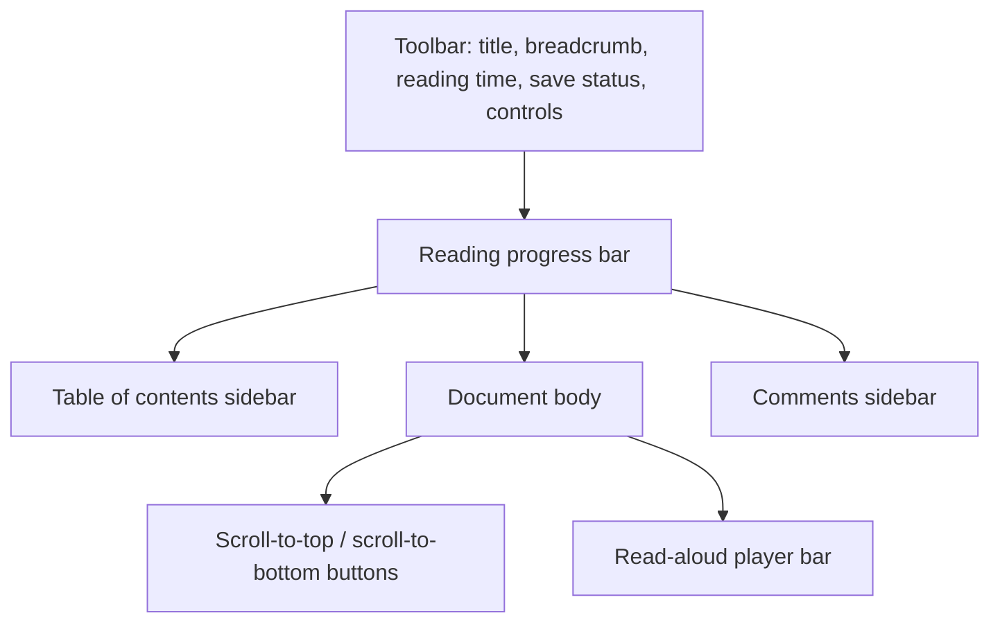
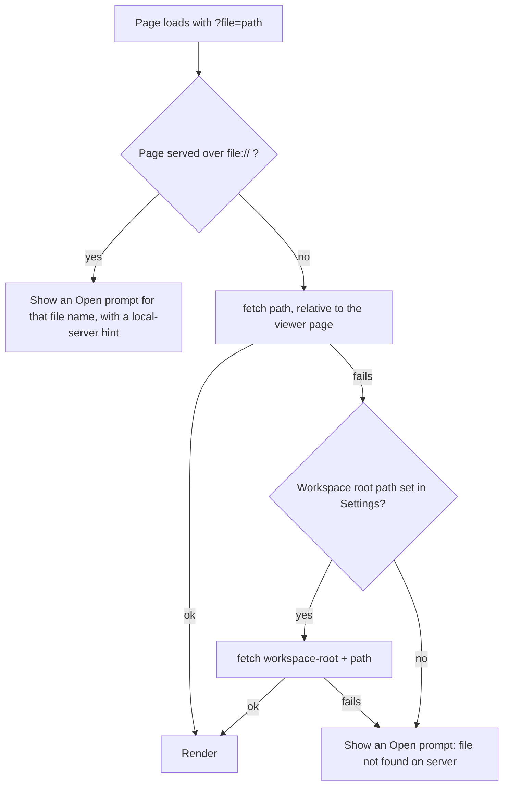
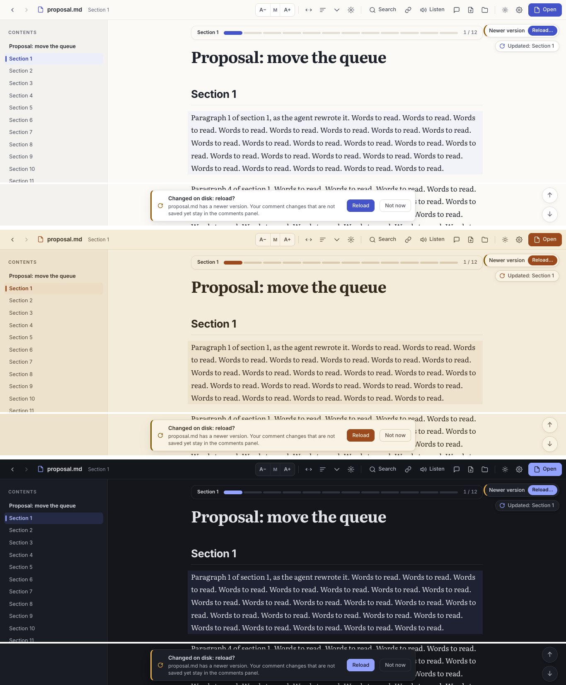
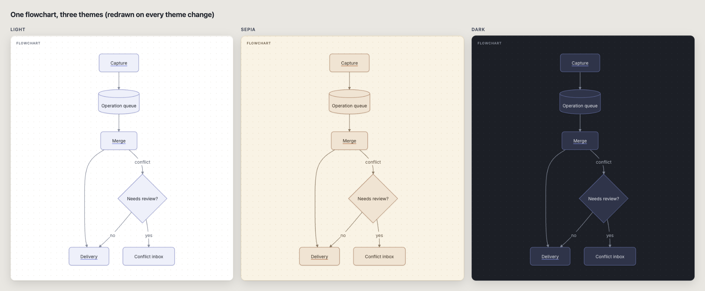

# Features

This is the user-facing reference for `markdown-viewer.html`: every control, panel and overlay, what each one does, and the function that implements it. It describes the code as of the initial import; the reading aids (outline, scroll spy, folding, search, dialogs, keyboard shortcuts and read-aloud) are described as of the reading-aids change of 2026-10-10, and their behaviour is covered by `tests/e2e/reading-aids.spec.mjs`. Behaviour I inferred rather than read is marked *(inferred)*. Behaviour I could not confirm is marked *(unverified)*.

Related documents:

- [rendering.md](rendering.md): how markdown becomes HTML (markdown-it, plugins, KaTeX, Mermaid, highlight.js).
- [read-aloud.md](read-aloud.md): the text-to-speech player in detail.
- [commenting.md](commenting.md): threaded comments stored inside the markdown file.
- [architecture.md](architecture.md): how the single file is organised.
- [visualization-catalog.md](visualization-catalog.md): which diagram and visual types render.
- [authoring-guide.md](authoring-guide.md): how to write markdown that uses these features.
- [roadmap.md](roadmap.md): planned work, including fixes for the limitations listed at the end of this page.

> [!NOTE]
> A document is treated as untrusted input. Raw HTML embedded in markdown is rendered (`markdown-it` is created with `html: true`), but everything rendered from a document goes through DOMPurify before it reaches the page (`mdvSanitize`); Mermaid is pinned to `securityLevel: 'strict'` whatever a caller or a `%%{init}%%` directive asks for (`mdvPinMermaidSecurity`); and the page's Content Security Policy (`script-src 'self' file:`) refuses inline script. `tests/e2e/security.spec.mjs` opens hostile documents and checks that nothing runs. Details: [rendering.md](rendering.md#security-posture).

---

## Screen layout



Before a document is loaded, the body shows a welcome screen with a drop zone, a **Browse files** button and a hint that you can paste markdown. Several toolbar buttons stay hidden until a document has rendered: fold-all, links panel, read aloud and comments.

### Toolbar controls, left to right

| Control | Tooltip | What it does | Implementing function |
|---|---|---|---|
| Folder icon (left edge) | Files in a folder | Shows or hides the [folder sidebar](#a-folder-of-documents); with no folder open, opens one first. Hidden at 600 px or less, with the clock icon: phone browsers cannot list a folder. | `mdvTreeToggle`, `mdvFolderOpen` |
| Clock icon | Recent documents | The [recent documents](#recent-documents) menu, with **Clear the list**. | `mdvRecentsOpenMenu` |
| `‹` / `›` | Back to *name* (Alt+←) / Forward to *name* (Alt+→) | Back and forward between the documents you opened (see [Back and forward](#back-and-forward)). Shown once there is somewhere to go; each names the document it goes to, and the one with nowhere to go is dimmed. | `mdvHistoryBack`, `mdvHistoryForward` (`js/history.js`) |
| Title | — | Shows the file name. | `renderMarkdown` |
| Breadcrumb | — | Shows the file path if the title contains `/`. When you scroll, it shows the current heading. Hidden at 900 px wide or less. | `renderMarkdown`, `setupScrollSpy` |
| Reading meta | — | Word count and estimated minutes at 230 words per minute. Hidden at 900 px wide or less. | `renderMarkdown` |
| Save status | — | Comment save state, for example "Saving…", "Saved ✓" or a call to set a save location. | `mdvSetStatus` |
| `A−` / size label / `A+` | Smaller text / Larger text | Five reading sizes. | `changeFontSize`, `applyFontSize` |
| Width icon | Toggle page width | Switches between a narrow reading column and full width. | `toggleWidth` |
| Contents icon | Table of contents (Ctrl+B) | Shows or hides the table of contents. | `toggleToc` |
| Chevron icon | Fold/Unfold sections | Collapses or expands every section. Shown after a document loads. | `toggleAllSections` |
| Focus icon | Focus mode | Dims everything except the block under the pointer. | `toggleFocus` |
| **Search** | Search (Ctrl+K) | Opens the search overlay. | `openSearch` |
| Link icon | All links | Opens the links panel. Shown after a document loads. | `toggleLinksPanel` |
| **Listen** | Read aloud | Opens the read-aloud player. Shown after a document loads. | `ttsToggle` |
| Speech-bubble icon with a badge | Comments (Ctrl+Shift+C) | Opens the comments sidebar. The badge counts open (unresolved) threads. Shown after a document loads. | `mdvToggleSidebar`, `mdvRenderSidebar` |
| File-plus icon | Open .md / set save location (Chromium) | Opens a file with write access. If a file is already loaded without a save location, links it to its file (an Open dialog; a Save dialog for pasted text) instead. | `mdvOpenOrSetSaveLocation` |
| Folder icon | Set workspace folder | Asks once for a folder. Files from that folder can then be saved without further prompts. | `mdvPickWorkspace` |
| Sun icon | Theme | Dropdown with Light, Sepia and Dark. | `toggleDropdown`, `setTheme` |
| Gear icon | Settings | Opens the settings panel (workspace root path). | `toggleSettings` |
| **Open** | Open file | Opens a read-only file picker. | `handleFileInput`, `readFile` |

---

## Opening documents

There are seven ways to get a document into the viewer. They differ in one important way: whether the viewer gets a **writable file handle**. Comments can be saved back to the file only when it has one (see [commenting.md](commenting.md)).

| Method | How | Writable? | Implementing function |
|---|---|---|---|
| **Open** button or `Ctrl/Cmd+O` | Hidden `<input type="file">` that accepts `text/*`, `.md`, `.markdown` and `.mdx` | No. If a workspace folder is set and holds a file with the same name, the viewer links to that file. | `handleFileInput`, `readFile`, `mdvTryWorkspaceMatch` |
| Drag and drop | Drop a file anywhere on the page. Only `.md`, `.markdown`, `.mdx`, `.txt` and `.text` are accepted. In Chromium the file is read through a handle (`getAsFileSystemHandle`), so live reload follows it; comments ask for permission to save into it the first time. | Chromium: with permission. Elsewhere no, apart from the same workspace-folder match | `document.body` `drop` listener, `mdvOpenFileHandle` or `readFile` |
| Paste | Paste more than 10 characters of text anywhere (except while search is open) | No | `document` `paste` listener |
| `?file=` URL parameter | `markdown-viewer.html?file=path/to/doc.md` | No | `loadFromUrl` |
| `#demo` URL hash | `markdown-viewer.html#demo` with no `?file=` loads a built-in demo document | No | `loadFromUrl`, `loadDemo` |
| Writable open (file-plus icon) | File System Access picker for `.md`, `.markdown` and `.txt` | Yes (Chromium only) | `mdvPickFile`, `mdvOpenWithHandle` |
| Automatic reopen | When the page loads, it reopens the last file opened with write access. The `load` listener checks for read permission, then `mdvOpenWithHandle` asks for read-write permission if it is not already granted. Without a user gesture that request is expected to fail silently, so in practice the reopen happens only while read-write access is still granted *(inferred)* | Yes | `load` listener using `mdvGetHandle('current')`, `mdvOpenWithHandle` |

Every way of opening a document ends in one function, `mdvOpenDocument` (`js/files.js`; see [the load seam](#the-load-seam-for-other-features)), and each document becomes a place in the tab's history ([Back and forward](#back-and-forward)). The address bar follows the document: after the Open button or drag and drop it reads `?file=<name>`, after a paste `?file=pasted` (as before), after a `?file=` link or a link followed inside the viewer `?file=<path>`, and a file opened through a handle (the writable open, the folder) has no `?file=`, so reloading the page reopens the last file. Only the file name is used for a chosen or dropped file, so reloading that address loads it only if a server can supply it under that name. The tab title is `<name> - Markdown Viewer` for every document (`mdvShowTitle`).

### How `?file=` is resolved



Implemented by `loadFromUrl`.

- **The `file://` limitation.** Browsers do not let a page opened from disk `fetch` other files on disk. When the viewer is opened as a `file://` URL, `?file=` cannot load anything. The viewer instead shows a drop zone titled "Open: *name*", a **Browse to *name*** button, and a suggestion to serve the folder with `python3 -m http.server 8080 --bind 127.0.0.1`.
- **Workspace Root Path** (Settings) is a **URL prefix** that is tried second. Despite the placeholder `/path/to/your/workspace/`, it is not a filesystem path. It is joined to the `?file=` value and fetched from the same server, so it helps only if the server exposes that path *(inferred from `loadFromUrl`)*. `saveBasePath` adds a trailing `/` if it is missing. The setting is stored in `localStorage` under `mdv-basepath`.
- Until wave 2, a file loaded through `?file=` or the writable open left the tab title at "Markdown Viewer"; every document now sets it.

### Linking a file to a save location

These two buttons only matter for comments:

- **File-plus icon** (`mdvOpenOrSetSaveLocation`). With no document loaded, it opens a writable file. With a document that has no writable handle and was read from a file (opened with Open, by drag and drop or through `?file=`), it opens an **Open** dialog: pick that same file, and the first save checks that it still holds the version you opened (a file changed since, or a different file, gets a conflict notice instead of being overwritten). Pasted text gets a **Save As** dialog and is written into that new file straight away. Unsaved comment changes are saved straight away too. In browsers without the File System Access API, and for a file whose comments are read-only, it opens the file chooser.
- **Folder icon** (`mdvPickWorkspace`). You pick a folder once with read-write permission. The handle is stored in IndexedDB (`mdv-viewer` database, `handles` store, key `workspace`). Later, when you open a file whose name matches a file at the top level of that folder, the viewer links to it with no prompt (`mdvTryWorkspaceMatch` uses `getFileHandle(filename)`, so subfolders are not searched).

---

## A folder of documents

For a reader of notes that live in folders of related documents (status reports, handoffs, proposals): a sidebar of
the folder's Markdown files, quick open, search in files, recent documents and link previews. `js/folder.js` is the
folder itself (`window.mdvFolder`, its path arithmetic in `folder-paths.js`); `folder-open.js` opens its documents;
`folder-tree.js`, `quick-open.js`, `folder-search.js`, `recents.js` and `link-preview.js` are built on it, with their
styles in `css/folder.css`. They show a document only through `mdvOpenDocument` (`js/files.js`). Tests:
`tests/e2e/folder*.spec.mjs` (helpers in `folder-helpers.mjs`); the desktop app's own walk: the shell's unit tests
(`desktop/src-tauri/src/folders.rs`) and its self-test (`--expect folder`).

### Opening a document from the folder

Every way the folder opens a document (the sidebar, quick open, search in files, recent documents) goes through
`js/folder-open.js`:

- **The last request wins.** Each request takes a ticket before it reads the file; a read that finishes after the
  reader asked for another document (a large file, a busy disk) is dropped, so the document on screen is always the
  last one asked for.
- **The reader's place is kept.** As the reader leaves a document of the folder, the load seam hands over their place in
  it (`mdvOnDocumentOpening`); going back to it from the sidebar, quick open or the recent menu opens it there
  (`mdvOpenDocument`'s `position`), as Back and Forward do. A document never read before opens at its top; search in
  files opens at the match.
- **After a reload,** the document the reader was reading comes back (the comment code reopens the `current` file at
  startup; every document shown from a file handle is kept as that file, `mdvRecentsRememberLast`).

### Opening a folder

- **Browser (Chromium):** the folder button asks for a folder with `showDirectoryPicker` (read access only). Firefox and
  Safari cannot list a folder; the sidebar says so.
- **Desktop app:** the folder button opens the document's own folder, or the folder you chose before when it holds the
  document; **Open another folder…** (in the sidebar) shows the native folder panel (`mdv_choose_folder`). The shell
  lists it (`mdv_list_directory`).
- **What is listed:** Markdown files (`.md`, `.markdown`, `.mdown`, `.mkd`, `.mkdn`, `.mdwn`, `.mdtxt`, `.mdtext`),
  never inside `.git`, `node_modules` or any folder whose name starts with a dot. The listing stops at 5,000 files,
  8 folders deep, or 100,000 folder entries looked at, and says so. Both builds walk the same way, breadth first, so a
  limit keeps the files nearest the top.
- **Remembered:** the browser keeps the folder's handle in IndexedDB (`folder`) and lists it again on the next visit
  when the browser still allows it; otherwise the sidebar offers **Reconnect**, and the browser asks again on that click.
  The desktop app keeps the folder's path (`mdv-folder`) and whether the sidebar was open (`mdv-folder-panel`), and a new
  window opens with it.
- **Kept current:** the folder is listed again when the window comes back into focus, when quick open or search in
  files opens (each at most every 5 s), and by the sidebar's refresh button. A listing that finds the same files keeps
  the tree on screen as it is, with no sorting or drawing again (in the desktop app it still takes each file's new size
  and time, so search in files reads a rewritten file again).

### Folder sidebar

- A panel at the left edge, before the outline (which moves over for it; at 900 px or less it slides in over the
  page). Its header names the folder and holds **Go to a file**, **Search in files**, **refresh**, **Open another
  folder…** and **hide**.
- A tree of the folder's Markdown files: folders first, then files, each by name (numbers in numeric order); each
  folder shows how many files it holds; `.md` is left off the names and other extensions are tagged. A folder of 40
  files or fewer opens fully; a larger one opens down to the current document.
- The document on screen is marked and kept in view, whichever way it was opened (`mdvFolderNoteShown`).
- **Click** (or Enter, or Space) opens a file through `mdvOpenDocument`; in the desktop app **Cmd/Ctrl-click** opens it in
  its own window, as a link does. At 900 px or less the panel closes after a pick.
- **Filter:** typing narrows the tree to the files whose paths hold every word typed, with the words marked, and says
  how many match. Down moves into the tree, Enter opens the first match (and moves into it), Esc clears it.
- **Keyboard (WAI-ARIA tree):** one row is in the Tab order; Up and Down move, Right opens a folder (then moves into it),
  Left closes it (then moves to its parent), Home and End, typing a name's first letters moves to it (`?` stays the
  shortcuts sheet). **Enter**, or a click, opens a file and moves the keyboard focus into the document, so Space and the
  arrows scroll it; **Space** opens it and stays in the tree, to look through files. **`Ctrl/Cmd+Shift+E`** comes back to the tree from anywhere, showing the sidebar
  first when it is hidden. Rows carry `role="treeitem"`, `aria-level`, `aria-setsize`, `aria-posinset`, folders
  `aria-expanded`, and the current document `aria-selected` and `aria-current`.
- **The toolbar:** the folder button and the recent-documents menu sit at its left. Between 901 and 1,180 px they take
  the room of the word count and reading time, which are hidden there, so the document's name keeps its place.
- Names from the file system are always set as text.

### Quick open

`Ctrl/Cmd+P`, or the sidebar's **Go to a file**: a dialog that finds a file from a few letters of its name or path. Every
letter typed must appear in order; a path ranks higher when the letters start words, run together, or fall in the file's
own name, and words separated by spaces must each match (`hnd ui` finds `handoffs/2026-10-08-ui.md`). With nothing
typed it lists the recent documents first, then the folder's files, the most recently changed first (a browser learns the
files' times in the background as the dialog opens, `mdvFolderLearnTimes`). Up and Down move, Enter opens,
`Ctrl/Cmd+Enter` opens in a new window in the desktop app, Esc closes. With no folder open it searches the recent
documents, and the desktop app opens the document's folder for it (`mdvQoOpen`, `mdvFuzzy`).

- **A file an agent has just written** is found: a listing more than 5 s old is taken again as the dialog opens, and the
  list follows when it arrives, keeping a row the reader moved to with the arrows.
- **"No file in “handoffs” matches"** names the folder it looked in: in the desktop app that is the document's own folder
  unless the reader opened another.
- A recent document from another folder of the same name is not taken for this folder's file (`isSameEntry`).

### Search in files

`Ctrl/Cmd+Shift+F` whenever a folder is open (its sidebar shown or not), or the sidebar's **Search in files**: full text
over every file in the folder, grouped by file, with each file's match count and up to five matching lines, one row per
line (line number, about 130 characters around the words, every match on the line marked). Enter or a click opens the
file and goes to the match: the rendered block that holds it is unfolded, scrolled into view and flashed, and the words
themselves are highlighted for four seconds (the CSS Custom Highlight API; nothing in the document changes). Enter
pressed before the results for what was typed are there (right after typing, or while the first search reads the
folder) goes to the first match once they are; typing on cancels that.

- **Finding the block:** every block of the page that holds the words is a candidate, in reading order, with the
  occurrences it holds numbered as in the file; the words of the match's line, the heading it sits under and where it
  falls in the file decide, so a short line (`- v2`) is found by its place (`mdvXsReveal`).

- **Lazily and in the background:** the files are read the first time the dialog opens, eight at a time, in slices of
  about 12 ms, so the page never waits; a newer query stops an older one. Each later opening reads again only the files
  whose size or time changed, so documents rewritten while you read are searched as they are now.
- **Limits:** a file over 1 MB, and anything past 64 MB in all, is not read (the dialog says how many); at most 200 files
  are listed. The comment block at the end of a file (`MDV-COMMENTS`) is not searched. The search index belongs to the
  folder as opened, never to its name.
- "No matches in “notes”" names the folder searched.
- `Ctrl/Cmd+Shift+F` folds or unfolds every section only when no folder is open (`toggleAllSections`); the toolbar's
  fold button always does. The `?` sheet lists both, each with when it applies.

### Recent documents

The last 15 documents you had on screen, newest first, on the welcome screen (with **Open a folder…** and **Clear**)
and in the toolbar's clock menu (with **Clear the list**); each shows its name, its folder and when you opened it, and a
click opens it again, at the reader's place in it when they read it in this session. Recorded whichever way a document
was opened (`mdvRecentsNote`, from `mdvFolderOn('shown')`).

- **Desktop app:** every document, by path (`localStorage` `mdv-recents`). An empty window opens a recent document as a
  double-click would (`mdvHost.openPath`); a window that shows a document opens it in place; Cmd/Ctrl-click opens it in
  its own window.
- **Browser:** documents read through a file handle (opened from a folder, with the file-plus button, or reopened at
  startup), kept as the handle (IndexedDB `mdv-recents`); the browser may ask again for permission on the click. A file
  dropped on the page or picked with the plain **Open** button comes with no handle and cannot be opened again, so it
  is not listed.
- A recent document that is gone is taken off the list with a note.

### Link previews

Resting the pointer on a link to another Markdown document, or reaching it with Tab, shows after a moment a card with
that document's title (its frontmatter `title`, else its first heading, else its file name), its first paragraph and
where it is. A link to a section (`plan.md#risks`) shows that section's heading and first paragraph, and names the
document. Links get one when they lead to a Markdown file in the open folder, and in the desktop app to any Markdown
file. The card replaces the link's address tooltip; it goes away when the pointer leaves the link and the card, on a
key that is not a modifier (holding Ctrl, Cmd, Shift or Alt for a click leaves it), on a scroll or a click.

- **As the file is now:** what a card shows is kept per link and used again only while the file's size and time are
  unchanged (a browser asks the file without reading it; the desktop app reads it again).
- **Nothing loads:** the other document is untrusted input like any document. Only its block structure is parsed
  (`md.block.parse`); its title and paragraph go through markdown-it and the render path's DOMPurify instance and
  configuration, made stricter (`mdvPreviewSanitize`): no images, media, SVG, MathML or form controls, and no `style`
  attribute (it can fetch through `url()` or `image-set()`) nor any attribute that holds an address (`background`,
  `src`, `srcset`, `href`, `poster`, …). Links become text, images their alt text, math its TeX source, and the card is a
  `[data-mdv-document]` container. Resting on a link fetches nothing, so it cannot tell anyone the link was rested on.
## Following documents: live reload, Back and Forward, and links

Status reports, plans and handoffs change while they are read, and they link to each other. Three features
serve that reader. Their code is `js/live-reload.js` (and what it shows, `js/live-notes.js`), `js/history.js`, `js/document-links.js`,
the reader's place in `js/reading-place.js` and the load seam in `js/files.js`; their browser tests are `tests/e2e/live*.spec.mjs`.



### Live reload

When the file of the document on screen changes, the viewer shows the new version **where you are reading**: the
words at the top of the window (the paragraph, list item, table row, code block or heading under the toolbar) stay
at the same height on screen, whatever was added or renamed above them **(tested: a newest-first log that gained a
day, a handoff that gained a "### Details" above the reader, text added above and the reader's heading renamed)**.
The place is found by those words and the headings of the sections around them, never by a heading's id:
markdown-it-anchor numbers headings that share a name (`notes`, `notes-1`, …), so a heading added above renumbers
every later one. When the reader's own words changed, the heading above them is found the same way; with neither,
the same proportion of the page. Sections you folded stay folded and `<details>` you opened stay open **(tested)**.

The blocks that changed are marked for a moment, and a quiet note at the top right says where: **Updated: Status**,
or **Updated: Status and 2 more** (`mdvLiveAnnounce`) **(tested)**. A reload is not a new place in Back/Forward.

| The document came from | How a change is noticed | How often |
|---|---|---|
| A file opened with a handle (dropped on the page in Chromium, the writable open, the automatic reopen, a workspace match, a folder) | the file's modification time and size (`getFile()`); the text is read only when one of them moves | every 1.5 s |
| A `?file=` link, or a link followed inside the viewer, over `http(s)` | a request, conditional (`If-None-Match` / `If-Modified-Since`) when the server sends validators, so that an unchanged file costs a `304` and no body | every 2 s |
| The desktop app, the window's own file | the shell watches it; `js/host.js` shows the new version, this adds the note | on change |
| The desktop app, a document opened in the window from a link | the shell does not watch it, so the page reads it through the bridge | every 2 s |

- **Only while the page is visible.** A hidden tab or minimised window looks at nothing; when it is shown again
  it looks at once **(tested)**.
- **What a look costs.** For a file opened with a handle, the time and size (no read) every 1.5 s; its text is read
  only when one of them moves. Over http, a `304` with no body when the server sends `ETag` or `Last-Modified`
  (Python's `http.server` sends `Last-Modified`); otherwise the whole file. A file over 1 MB that is read whole on
  each look (the desktop bridge, a server without validators) is looked at every 10 s. A look that fails (the server
  answers with an error, or does not answer) waits twice as long each time, up to 30 s, and the first look that
  succeeds goes back to the normal pace **(tested)**.
- **A look that never answers is given up after 8 s**, so a server that hangs or a network volume that stalls never
  stops the looks that follow, and a look about a document no longer on screen is dropped **(tested)**.
- **A file that is not on disk** (removed, renamed, a branch switch) says so at the top right: "*name* is not on
  disk: the last version stays here". It is asked about every 4 s over http (each miss is a line in the browser's
  console) and at the usual pace otherwise, so it shows within a few seconds of coming back **(tested)**.
- **Never a half-written file.** A program that saves by emptying the file and then writing it would otherwise be
  caught in between, and you would lose your place to an empty page. A new version is shown when two looks 300 ms
  apart agree **(tested)**. A file that keeps changing (an agent writing into it all the time) is shown at every third
  look that sees another version instead of never, and is not read more than once per look; an empty version is
  never shown while the file is changing **(tested)**.
- **Whole-second time stamps are not trusted while they are fresh.** Two versions saved within one second can
  share a `Last-Modified`; a conditional request with it could be told "not modified" about the second one. A
  response whose `Last-Modified` is less than 2 s older than its `Date` is not used as a validator, and the next
  look asks for the whole file **(tested)**.
- **The viewer's own comment saves are not changes.** The text on disk is compared with the version the comment
  code last read or wrote (`mdvBases`), so saving a comment never reloads the page **(tested)**. Nothing is looked at
  while a comment save is writing the file **(tested)**, and a change found while one starts is left to the comment
  code, which refuses to write over another program's change.
- **Unsaved comment work is never replaced.** If the document has comment changes that are not in its file yet (a
  change not written, a save in flight, a conflict or error notice for this document), a question appears at the
  bottom instead: **Changed on disk: reload?** **Reload** (or `Alt+R`) shows the new version, and the comment changes
  stay in the comments panel to download (the comment code keeps the text of a document it no longer shows). **Not
  now** keeps reading the current one, and a quiet mark at the top right, **Newer version on disk · Reload…**, stays
  until you reload: later versions do not ask again (an agent saving every minute would ask every minute); the mark's
  **Reload…** (or `Alt+R`) asks again with **Reload** focused **(tested)**. Comment changes that Back brings back
  (below) count too. When the comment code is already asking about the file (its conflict notice offers **Reload from
  disk**), nothing else asks **(tested)**. In the desktop app, the window's own file keeps its own question from
  `js/host.js`.
- **A comment being written holds the new version.** While the add-comment box is open (typed into or not) or a reply
  has text in it, nothing is replaced and nothing asks: the mark says **Newer version on disk: shown when you close
  the comment box**, and the new version is shown when the box closes (or asked about, when the comment left unsaved
  work). Saving the box still works: the box never points at text that is gone **(tested)**.
- **A copy says so.** The Open button (a file input) gives the page a snapshot of the file, not the file: the mark
  says **A copy: changes to its file do not show here**, and in Chromium its **Follow…** opens the file itself through
  the File System Access picker, in its place, after which it is followed **(tested)**. A file dropped on the page is
  read through a handle in Chromium and followed **(tested)**. Not followed: pasted text, files dropped or chosen in
  Firefox and Safari, and documents on a `file://` page, which cannot fetch.

### Back and forward

Every document you open is a place in the tab's own history, with your place in it: the file chooser, drag and
drop, paste, `?file=` links, the writable open and links between documents **(tested)**; the folder sidebar and
quick open show documents through the same seam. Go back and forward with:

- `Alt+←` and `Alt+→` (`⌥←` and `⌥→` on a Mac), registered with `mdvRegisterShortcut`, and in the desktop app the
  **Go** menu (`⌘[` and `⌘]` on a Mac);
- the **‹** and **›** buttons at the left of the toolbar.

These go to the previous or next **document**: they step over the places inside the document on screen (an
in-document link such as a contents line, a heading's `#` permalink), and each button names the document it goes to
**(tested)**. The browser's own Back and Forward buttons (and its `⌘[`, `⌘]`) move one place at a time, as always.

Each document comes back as you left it **(tested)**: at the same words, with the focus on the link you followed
out of it (so the keyboard goes on from there), and with the comment changes it had, still unsaved, so live reload
asks before it replaces them **(tested)**. Its file is read again first, so the version on disk now is the one shown,
never the old one first; when it changed while you were away, a note says **Updated since you left** **(tested)**.
Following a link puts the focus at the new document's start **(tested)**. A link followed or a Back pressed while an
earlier one is still reading its file wins, and the places stay right **(tested)**.

After a reload of the page, Back and Forward still name and reach the documents: the places are kept in
`sessionStorage` **(tested)**. A document that cannot be read again (a file opened through a handle, a removed file)
says so, and the page and its address stay **(tested)**. With nowhere to go back to, `Alt+←` is left to the browser.

### Links between documents

A relative link to a Markdown file (`.md`, `.markdown`, `.mdown`, `.mkd`, `.mkdn`, `.mdwn`, `.mdtxt`,
`.mdtext`), in the document or in the links panel, opens **inside the viewer** instead of leaving it:

| Where you are reading | The link is opened through | Cmd/Ctrl-click |
|---|---|---|
| A document of the open folder | the folder: `mdvFolder.resolve(from, href)`, then `mdvFolder.read(path)` | as below |
| The desktop app | `mdvHost.readDocument`, in the same window **(tested with a stand-in shell, and in the macOS app by its self-test)** | opens it in a window of its own (`js/host.js`) |
| A page served over `http(s)` | `fetch`, relative to the document's own address, not the viewer's **(tested)** | the viewer for that file, in a new tab **(tested)** |
| A `file://` page | the browser's own behaviour | the browser's own behaviour |

Over `http(s)` each such link carries the viewer's own address for its file (`markdown-viewer.html?file=…`), so every
gesture the browser offers opens the viewer: a middle click, **Open link in new tab**, **Copy link address**, and the
address the status bar shows **(tested)**. The link as the document wrote it is kept aside (`mdvLinkHref(a)`).

A link with a `#fragment` opens at that heading or anchor, unfolded and focused; a link to the document on screen
goes to its fragment like an in-document link. A file that cannot be read says so in a notice ("missing.md could
not be opened: it was not found.") and the page stays where it is **(tested)**. Web, mail and `file:` links, and
links to other kinds of file, keep their usual behaviour.

### The load seam, for other features

`mdvOpenDocument({name, text, path, handle, mtimeMs}, {push})` (`js/files.js`) is the one way to show a document.
`push: true` (the default) makes it a new place in Back/Forward; `push: false` shows it in the current place (a
reload, or Back itself). It keeps the reader's place when the same document is shown again, links the document to
the handle it was read from (or to none), points the desktop bridge at the document's path, and sets the title.
With a handle, text the comment code has not read through that handle is read again through `mdvOpenWithHandle`,
so a comment save compares the file with what is shown. **The newest open wins:** an open that reads a file through a
handle gives up before it renders when another open began (or another document was shown) meanwhile, and resolves
`false`; `mdvOpenSeq` counts opens, so a caller can tell that it was overtaken rather than refused **(tested)**.
Every render of a document, through the seam or not, is reported: `mdvShownDocument()` is the record of the document
on screen, `mdvOnDocumentOpening(fn)` runs just before a document replaces the page and `mdvOnDocumentOpened(fn)` once
it is shown, with an event whose `kind` is `first`, `open`, `reload` or `history`; `mdvOnDocumentDrawn(fn)` runs after
every render, the comment code's own redraws included. Recent documents and other features that follow the document
subscribe there.

---

## What happens when a document renders

`renderMarkdown` runs the same pipeline for every opening method:

1. Strip YAML frontmatter (`parseFrontmatter`) and build the [frontmatter dashboard](#frontmatter-dashboard).
2. Collect `<!-- narrate: ... -->` comments for read-aloud (`extractNarrations`).
3. Render with markdown-it and its plugins. Math is one of its rules (`js/math.js`): KaTeX typesets each `$...$` and `$$...$$` during the parse, following Pandoc's dollar rules, and never inside code.
4. Sanitize the dashboard and the rendered HTML with DOMPurify (`mdvSanitize`), and show the result. If steps 1–4 throw, the error and the document's text are shown instead (`mdvRenderErrorHtml`).
5. Post-process. Each step is wrapped so one failure does not block the rest. In order: callouts, section toggles, table of contents, section minimap, search index, read-aloud sections, Mermaid diagrams, scroll spy, image lightbox, link enhancement, abbreviation tooltips, diagram click-to-jump.
6. Reset the fold-all state and scroll to the top.

The commenting layer wraps `renderMarkdown`. It reads the `MDV-COMMENTS` block first, then attaches the right-click menu and the comments sidebar 50 ms after rendering. See [rendering.md](rendering.md) for the markdown details.

---

## Reading aids

### Table of contents

- **Built by** `buildToc`. It lists every H1–H6 in the document, by the heading's own words (`mdvHeadingText`: without the fold chevron, the permalink `#` or comment chips; a `#` the author wrote, as in "C# tips", is kept). H1 and H2 entries share one indent; H3–H6 are indented progressively further (CSS on `.toc-link[data-level]`). A heading without an `id` gets one (`heading-<n>`). The sidebar is a `nav` named "Table of contents".
- **Click an entry** (or Tab to it and press Enter) to scroll smoothly to that heading. A heading inside a folded section is unfolded first, and the keyboard focus moves to the heading, so Tab continues from there. On narrow screens the overlay also closes. One delegated listener on `#tocList` handles every entry.
- **Toggle** with the toolbar button or `Ctrl/Cmd+B` (`toggleToc`). Wider than 900 px, the sidebar hides and the content takes the full width. At 900 px or less, the sidebar is off-canvas and the toggle slides it in as an overlay; `Esc` closes it.
- **A hidden outline is inert** (`mdvSyncTocInert`): out of the Tab order and away from screen readers, whether it was hidden by the toggle or is off-canvas on a narrow screen **(tested)**. Before, every outline link stayed a tab stop while hidden, where the focus could not be seen: 25 on `kitchen-sink.md`, one per heading on any document.
- **No headings:** the sidebar is hidden and the content uses the full width. The next document with headings shows the sidebar again as you left it (before, it stayed hidden until toggled twice).
- **Not remembered** between page loads.

### Scroll spy and breadcrumb

The current heading is the last visible heading whose top is above the reading line, 30% of the way down the window (at least 80 px, below the toolbar). One passive `scroll` listener, attached once for the page's lifetime, finds it at most once per animation frame with a binary search over the headings' positions (`mdvScrollSpyUpdate`); `setupScrollSpy` only hands it the new headings on each render. When the current heading changes:

- its table-of-contents entry is highlighted and marked `aria-current="location"`, and the sidebar scrolls (never the page) so the entry is visible;
- the toolbar breadcrumb changes to that heading's text, and back to the file path above the first heading;
- the section rail marks the H2 at or above it (see [Section minimap](#section-minimap)); the scroll spy is the only code that marks the rail, so the rail and the outline always name the same section **(tested)**.

It is right in both directions: scrolling back up into a long section highlights that section. The earlier version used an `IntersectionObserver` band, which only noticed headings entering the band, so the section below stayed highlighted; it also created a new observer on every render and never disconnected it. At the very end of a document that scrolls, the last heading on screen becomes current, so short final sections are reachable **(tested)**. A page too short to scroll is at its top as much as at its bottom, so there the reading line decides (before, a short note opened with its last heading current) **(tested)**. Headings inside folded sections or closed `<details>` are skipped (`mdvHeadingVisible`, which uses `checkVisibility()`: Chrome still reports a box for a heading inside a closed `<details>`) **(tested)**.

### Section minimap

`buildSectionMinimap` adds a rail of buttons, one per H2, but **only when the document has three or more H2 headings**.

- The rail is the first element of the document, ahead of the dashboard and the title (never between them), and outside every section, so the blocks inside sections keep their positions among their siblings (comment anchors record them). The column's top padding shrinks to make room for it. It stays under the toolbar while you read (`position: sticky`), so it always shows where you are. Jumps (outline, search, links, diagram nodes) land below it.
- With room, each segment shows its section's title, cut with an ellipsis when it does not fit. Hovering a segment, or reaching it with Tab, shows the full title in a tooltip. The labels are drawn by CSS from `data-label` and named for screen readers with `aria-label`, so they are not document text: search, read-aloud and copy never pick them up.
- When segments are narrower than 72 px (for example 17 sections in the reading column), they become a track: sections already read, the current one (larger, in the accent colour) and the ones ahead. The rail then names the current section and its position, "Architecture 3 / 17" (from `data-current` and `data-position`); outside every H2 section it names the H1 the reader is in, and above the first heading the document's first H1 ("Start" without one), with the number of sections ("17 sections"). The tooltip still names each segment. A `ResizeObserver` switches between the two modes when the column changes width.
- Clicking a segment goes to its H2 as an outline entry does (`mdvGoTo`): a folded section around it is unfolded first, and the keyboard focus moves to the heading **(tested)**. It used to only scroll, which did nothing for a heading inside a folded section.
- Where the reader is comes from the [scroll spy](#scroll-spy-and-breadcrumb), the only code that marks the rail, so the rail follows the outline's decision **(tested)**. The current segment (`.active`, `aria-current="location"`) is the H2 at or above the current heading, within its H1 (an H1's own introduction has none); the segments before it are marked read (`.passed`); `data-current` and `data-position` name it for the track. So the rail is right scrolling up as well as down, skips headings in folded sections and closed `<details>`, and at the very bottom of a page follows the last heading on screen. The spy finds segments by their `data-target-id`, marks the rail again when folding or a `<details>` changes which headings can be seen, and keeps the current segment in view if the rail scrolls. Until 2026-10-10 the rail also ran its own scroll listener with its own rule (`mdvUpdateMinimap`: the last H2 above the reading line), and the two marked different segments at the bottom of a page and past a closed `<details>`.

### Collapsing and expanding sections

- **Per section** (`addSectionToggles`, `toggleSection`). Every H1–H4 gets a chevron button at its start. The content after the heading, up to the next heading of the same or a higher level, is wrapped in a collapsible container. A heading with no content after it keeps a hidden, inactive chevron. The chevron is a button named after its section ("Toggle section: C# tips"), with `aria-expanded` and `aria-controls` pointing at its container, so it works from the keyboard and screen readers announce its state. The heading itself is named by its own words (`aria-label`); before, the chevron inside it made every heading's name start with "Toggle section" **(tested in Chrome's accessibility tree; not with a screen reader)**.
- **The `#` permalink** after each heading is out of the Tab order (`tabindex="-1"`). It is invisible until hovered and already hidden from screen readers, so tabbing on from a heading (an outline jump puts the focus there) used to land on nothing visible **(tested)**.
- **What moves with a block.** The wrapper takes every node up to the next heading, including the HTML comments between blocks: a `<!-- narrate: -->` stays right before its diagram or table, and a comment thread's `<!-- MDV-ANCHOR -->` stays right before its block. Comments and whitespace after a section's last block stay outside, with what follows. Before, only elements moved, which lost narrations and attached comment threads to the next heading.
- **All sections** (`toggleAllSections`). The toolbar chevron or `Ctrl/Cmd+Shift+F` collapses or expands every section at once. Each new render starts with everything expanded.
- **Jumping into a folded section** (from the outline or search) unfolds it and opens a closed `<details>` around the target (`mdvReveal`) **(tested)**. Read-aloud unfolds every folded section around the blocks it is reading (`mdvUnfold`) **(tested)**.
- H5 and H6 cannot be collapsed separately. Their content folds with the nearest H1–H4 above them.

### Focus mode

`toggleFocus` toggles the `focus-mode` class on `<body>`. Its CSS:

- dims every block in the document to 30% opacity;
- returns the block under the mouse pointer to full opacity, along with the block being read aloud (`.tts-active`);
- leaves top-level headings at full opacity. Headings nested inside a section container are dimmed like other blocks *(inferred from the CSS selectors)*.

Toggle with the toolbar button or `Ctrl/Cmd+.`. Focus mode is not remembered.

### Page width

`toggleWidth` switches the reading column between its default maximum width (`--content-max-width: 72ch`) and 100% of the content area. Toggle with the toolbar button or `Ctrl/Cmd+\`. The width is not remembered.

### Font size

`changeFontSize` steps through five sizes. Each size also sets a line height (`applyFontSize` sets `--reading-size` and `--reading-lh`):

| Label | Size | Line height |
|---|---|---|
| XS | 0.92rem | 1.7 |
| S | 1rem | 1.75 |
| **M** (default) | 1.075rem | 1.78 |
| L | 1.15rem | 1.82 |
| XL | 1.25rem | 1.85 |

The choice is stored in `localStorage` under `mdv-fontsize`.

### Theme

`setTheme` sets `data-theme` on `<html>` to `light`, `sepia` or `dark`, and stores the choice in `localStorage` under `mdv-theme`. The default is `light`. The operating system's light or dark preference is not consulted *(inferred: no `prefers-color-scheme` rule exists)*.

- Each theme is one set of design tokens in `css/viewer.css`: surfaces, text, accent, callout, syntax and diagram colours. Every text colour meets WCAG AA (4.5:1) on the surfaces it is used on; `tests/e2e/visuals.spec.mjs` measures the pairs in all three themes.
- Code highlighting uses each theme's own syntax colours (the vendored highlight.js stylesheets still load, and the viewer's colours override them).
- Mermaid diagrams are drawn in the theme's palette: Mermaid's `base` theme, fed from the `--diagram-*` tokens. A theme change redraws every diagram already on the page from its saved source, and an open expanded view follows.



### Reading progress and scroll buttons

- A thin bar under the toolbar fills as you scroll (`scroll` listener).
- Two floating buttons scroll to the top and the bottom. The up button is hidden in the first 200 px of the page. The down button is hidden within 200 px of the bottom. At 600 px or less they are not shown: on a phone they covered the ends of the last lines of text.

### Search

Open with the **Search** button or `Ctrl/Cmd+K` (`openSearch`); `Ctrl/Cmd+K` again closes it. Search is a modal dialog: see [Dialogs](#dialogs-search-shortcuts-image-lightbox).

| Aspect | Behaviour | Function |
|---|---|---|
| What is indexed | Every heading, and the readable text of every paragraph, list item, table cell, definition, quote, code block, figure caption, `<details>` summary and link card (by its title) with at least 2 characters. Each entry holds only its own words: a nested list or a paragraph inside a quote has its own entry, so a sentence is never listed twice. The whole text is indexed (it used to stop at 200 characters, so later words were never found). Diagram source, an SVG's `<style>` and the viewer's own controls are left out **(tested)** | `buildSearchIndex` (on render: marks the index stale and drops the old results, or runs the open query again), `mdvSearchIndex`, `mdvIndexDocument` (on the first search after a render) |
| Matching | Case-insensitive substring match. Starts at 2 characters. Heading hits first, then blocks in reading order. At most 20 results | `handleSearch` |
| Results | Heading hits show `#` marks for their level. Content hits show the nearest preceding heading and about 160 characters around the first match. Matches are highlighted. The footer says how many matched ("3 matches", "First 20 of 57 matches", "No matches") and screen readers hear it | `handleSearch`, `mdvSnippet`, `mdvHighlight`, `mdvSearchStatus` |
| Keyboard | `↑` / `↓` move the selection and wrap around. `Enter` jumps to the selected result, or to the first one when none is selected. `Esc` closes | `handleSearchKeys` |
| Jump target | A heading hit scrolls to that heading. A content hit scrolls to the block itself and briefly highlights it (it used to scroll to the section's heading, which could leave the match off screen); the highlight then gives back any background colour the author set on the block **(tested)**. A folded section is unfolded and a closed `<details>` opened first, and the keyboard focus moves to the target | `goSearch`, `mdvGoTo`, `mdvFlash` |
| Close | `Esc`, `Ctrl/Cmd+K`, or a click on the dimmed backdrop | `closeSearch` |
| Screen readers | The input is a `combobox` controlling a `listbox` of `option`s; the selected result is its `aria-activedescendant` | `wireSearch` |

### Links

`enhanceLinks` processes every link in the document except heading permalinks.

**Type detection** (`detectLinkType`). The rules are checked in this order:

| Type | Rule | Suffix icon (CSS) |
|---|---|---|
| Section | `href` starts with `#` | none |
| Email | starts with `mailto:` | envelope |
| File | ends in `.md`, `.txt`, `.pdf`, `.doc`, `.csv`, `.json`, `.yaml` or `.yml` | arrow |
| GitHub | contains `github.com` or `gitlab.com` | star |
| npm | contains `npmjs.com` or `npm.im` | circle |
| Docs | contains `docs.`, `documentation`, `readme`, `wiki`, `.dev` or `.io/docs` | diagonal arrow |
| External | anything else | diagonal arrow |

**Behaviour:**

- **New tab.** Links whose `href` starts with `http` (and are not Section or File links) open in a new tab with `rel="noopener noreferrer"`.
- **Hover tooltip** (`showLinkTooltip`, `hideLinkTooltip`). Shows the type, a shortened URL (host and path; longer than 55 characters, it is cut to 52 characters plus `...`), `Jump to: …` for section links, the address for email links, and a **Copy** button that copies the full `href` (`copyLinkUrl`). The tooltip stays open while the pointer is over it.
- **Link cards.** A paragraph that contains nothing but one link, other than a `#section` link, is replaced by a card showing the link text, host and path, and a type badge.
- **Links panel** (`toggleLinksPanel`, `buildLinksPanel`). The link toolbar button opens a panel listing every link, grouped in this order: External, GitHub, Docs, npm, File, Section, Email. Each group header shows how many links of that type the document contains. Within a group, links with the same `href` are listed only once. Clicking a Section entry closes the panel and goes to the target as an outline entry does (`mdvLinkTarget`, `mdvGoTo`): a folded section or closed `<details>` around it opens, and the focus moves there **(tested)**. It used to only scroll, which did nothing inside a folded section.
- **In-document links** (`href="#…"` in the document, footnote references and back-links included) go to their target the same way (tested for a heading link and a footnote reference). Like the browser's own jump, the click adds a history entry with the fragment, so Back returns. A click with a modifier key, and the `#` permalink after each heading, keep the browser's behaviour. The target is found as the browser finds a fragment (an id, else an `<a name>`, as written and then percent-decoded), and only inside the document.
- **Links to other `.md` files** are ordinary browser navigation. The viewer does not open the linked markdown in itself *(inferred: no click handler for File links)*.

### Abbreviation tooltips

- **Markdown syntax** (works). The vendored `markdown-it-abbr` plugin turns `*[HTML]: Hyper Text Markup Language` definitions into `<abbr title="…">` elements, and the browser shows its native tooltip on hover.
- **Frontmatter `abbreviations:`** (works). `applyAbbreviationTooltips` wraps every whole-word occurrence of a key in a dotted-underline `<abbr class="abbr-tooltip" title="…">`, longest key first, skipping code, `pre`, `kbd`, math, diagrams, callout titles, the dashboard, the minimap and anything already inside an `<abbr>`. Both YAML shapes work: an indented map (`  API: Application programming interface`) and a list (`  - API: Application programming interface`). `parseFrontmatter` turns the indented map into an empty list, so `mdvFrontmatterAbbreviations` reads those lines from the document's own frontmatter, and only when that frontmatter parses to the one being rendered.

### Image lightbox

`setupImageLightbox` makes every image that is not inside a link a button named "Enlarge image: <alt text>": click it, or Tab to it and press `Enter` or `Space`, to see it enlarged (up to 92% of the viewport) on a dimmed overlay (`openLightbox`). Click anywhere or press `Esc` to close it (`closeLightbox`); the focus returns to the image. An image inside a link (a badge, for example) follows the link instead; before, a click opened the lightbox and followed the link. The lightbox is a modal dialog named after the image's alt text.

### Dialogs: search, shortcuts, image lightbox

Search, the shortcuts sheet and the image lightbox are modal dialogs (`mdvOpenModal`, `mdvCloseModal` in `js/navigation.js`):

- they have `role="dialog"`, `aria-modal="true"` and a name ("Search this document", "Keyboard Shortcuts", "Image: <alt text>");
- opening one moves the keyboard focus into it (the search box, the sheet's Close button, the lightbox itself), and neither the mouse, the keyboard nor a screen reader reaches what is behind it. The toolbar, panels and player are made `inert`. The document area (the outline and the document) is hidden from screen readers with `aria-hidden` instead, because making it inert restyles every node in it: on a 3,000-section document that took more than 100 ms each way. The backdrop takes the pointer, and a focus guard returns any focus that lands behind the dialog **(tested)**;
- `Tab` and `Shift+Tab` stay inside;
- `Esc` closes it, and the focus returns to whatever had it before (a jump to a search result moves the focus to the result instead). If nothing had the focus, the next `Tab` continues from where you last clicked in the page, or from the top of the page; before, it went to an invisible button at the top **(tested)**;
- while one is open, the viewer's other shortcuts do nothing, and the browser does not get them either (`Ctrl/Cmd+Shift+R` is its hard reload, `Ctrl/Cmd+O` its Open dialog); `Ctrl/Cmd+S` still saves. The expanded diagram counts as a dialog here: a shortcut pressed over it used to open search or the sheet underneath it, out of sight **(tested)**;
- only one is open at a time.

### Diagrams: expand, zoom and fit

Fenced code blocks tagged `mermaid` are drawn by `renderMermaidDiagrams` in the current theme's palette, each on a card labelled with its type (Flowchart, Sequence diagram, Pie chart…). [`samples/diagram-gallery.md`](../samples/diagram-gallery.md) shows every type in one file ([dark theme screenshot](images/visuals-diagram-gallery-dark.png); [the expanded view](images/visuals-overlay.png)). If a diagram cannot be drawn, its card says so, gives Mermaid's reason, and keeps the source readable underneath.

Once a diagram is drawn:

- an **expand** button appears in its top-right corner while the pointer is over the diagram (always, on touch screens), and clicking anywhere on the diagram also opens the expanded view (`openDiagramOverlay`);
- the expanded view shows a copy of the SVG, titled by the type Mermaid reports for it, plus the diagram's own title when it has one ("Pie chart · Estimated effort by area").

| In the expanded view | Effect | Function |
|---|---|---|
| Drag | Pan | pointer listeners on `#diagramBody` |
| Mouse wheel, trackpad pinch (ctrl + wheel), two-finger touch pinch | Zoom around the pointer, between 10% and 1000% | `mdvZoomAt` |
| `−` / `+`, or the keys `-` / `+` (`=`) | Zoom out / in by 25% around the centre | `diagramZoom` |
| **Fit**, or `0` | Fit the diagram to the screen; pressed again, actual size | `diagramFitToggle`, `mdvDiagramFit` |
| **1:1**, or `1` | Actual size | `mdvDiagramActualSize` |
| Arrow keys (with Shift: further) | Pan | keyboard listener |
| A click on a node that links to a section | Close the view and go to that section | `mdvJumpToSection` |
| **× Close** or `Esc` | Close, and give focus back to what opened it | `closeDiagramOverlay` |

The view opens fitted, re-fits when the window is resized in fit mode, keeps focus inside itself while open, and stays sharp at every zoom: the SVG is redrawn at its scaled size instead of being magnified. The zoom label shows the scale in percent. A theme change while the view is open redraws the diagram in the new palette and keeps the zoom and position.

### Clicking a diagram node to jump to a section

A node whose label is exactly the text of a heading in the document links to that heading (`mdvLinkDiagramNodes`). The match is on the label's slug, so case and punctuation do not matter, but the whole label must match: a node called "Merge" links to a heading "Merge", and a node called "Merge logic" does not.

- Linked nodes are underlined, show "Go to section: …" on hover, and are focusable with Tab and announced as links.
- A click, or Enter on a focused node, goes to the heading as an outline entry does (`mdvGoTo`: folded sections around it are unfolded, with their chevrons' `aria-expanded` and the scroll spy updated, and a closed `<details>` around it is opened), moves the focus to it and flashes it (`mdvJumpToSection`) **(tested)**. Until 2026-10-10 the jump unfolded sections by removing classes itself, so after a jump into a folded section its chevron still read "collapsed" and the outline and the rail marked the section above. A click elsewhere on the diagram still opens the expanded view; in the expanded view, a click on a linked node closes it and goes to the section.
- Linking runs after each diagram is drawn, so it works on the first render and after every theme change. `setupMermaidClickToSection`, which `renderMarkdown` calls, links any diagram already drawn.

### Code blocks

For fenced code blocks, the markdown-it `highlight` option (set where `md` is created) adds a header with the language name (`text` if none is given) and a **Copy** button (`copyCode`). highlight.js colours the code only when it recognises the language. Otherwise the code is shown escaped and uncoloured. Indented code blocks do not get the header.

The button copies exactly the code: not the language label, not the word "Copy", and not the fence's closing newline. It shows "Copied!" with a check mark for 1.6 seconds, or "Copy failed" if the browser refuses. Outside a secure context it falls back to the legacy copy command.

Each code block has a header with a coloured dot for common languages, the language name and the copy button. Long lines scroll inside the block, with a soft edge on the side the line continues to. Ligatures are off, so `!=` reads as two characters, as typed.

### Callout blocks

`transformCalloutBlocks` turns a blockquote into a coloured callout when its first paragraph starts with `[!TYPE]`. The type is not case-sensitive. The marker is removed and a title line is inserted.

```markdown
> [!TIP]
> Press `?` to see the keyboard shortcuts.
```

| Marker | Title | Accent colour | Icon |
|---|---|---|---|
| `[!NOTE]` | Note | blue | circled "i" |
| `[!TIP]` | Tip | green | light bulb |
| `[!IMPORTANT]` | Important | violet | speech bubble with "!" |
| `[!WARNING]` | Warning | ochre (amber in dark) | triangle with "!" |
| `[!CAUTION]` | Caution | red | octagon with "!" |
| `[!TLDR]` | TL;DR | teal | lightning bolt |
| `[!DECISION]` | Decision | magenta | circled check mark |
| `[!COST]` | Cost | rust (coral in dark) | price tag |

A callout has a tinted background, a strong left bar in its accent colour, and a title in that colour with its icon. Each theme sets the eight accent colours (`--callout-*` in `css/viewer.css`): the closest two are at least CIELAB dE76 20 apart in every theme, and each title meets 4.5:1 on its own tint. The tint is the accent mixed in oklab into a grey at the page's lightness (`--callout-base`), not into the page itself, so a cool callout on the warm sepia page keeps its own hue instead of turning khaki (`tests/e2e/visuals-content.spec.mjs`). The icons are drawn as inline SVG in the accent colour, so they look the same on every operating system. An unknown type leaves the blockquote unchanged. Text after the marker on the same line stays in the body; there is no custom-title syntax.

### Frontmatter dashboard

A YAML block at the very top of the file, between `---` lines, is removed from the rendered body. `parseFrontmatter` handles a small subset of YAML: top-level `key: value`, lists of plain strings, and lists of small `key: value` maps. Flow syntax such as `[a, b]` is kept as a literal string, and nested maps are not supported.

`renderFrontmatterDashboard` renders a panel above the document **only if at least one of `status`, `metrics` or `repos` is present** (`metrics` and `repos` count only as non-empty lists). `date` is shown only alongside them, and `abbreviations` is read by `applyAbbreviationTooltips`. All other keys are parsed and ignored.

```yaml
---
status: In Progress
date: 2026-01-15
metrics:
  - label: Pages
    value: "42"
repos:
  - name: viewer
    github: https://github.com/example/viewer
---
```

| Field | Shape | How it renders |
|---|---|---|
| `status` | string | A pill that shows the text, with hyphens and underscores read as spaces (`in-progress` shows as IN PROGRESS). Its colour depends on the text: anything containing `ship` is green (shipped), `progress` is amber (in progress), `block` is red (blocked), and everything else is grey (draft). |
| `date` | string | Shown with a calendar icon next to the status pill. Shown only when the dashboard itself is shown. |
| `metrics` | list of `{label, value}` | A row of cards that share its width, each with a small label over a large value. They wrap on narrow screens; a card alone on its row takes the whole row. |
| `repos` | list of `{name, github}` | A rounded badge per entry. With `github` set, the badge is a link that opens in a new tab and shows a link icon before the name (the star glyph render.js writes is kept in the text but hidden). Without it, the badge is plain text. `name` defaults to `repo`. |
| `abbreviations` | map, or list of `KEY: value` | Every whole-word occurrence of a key gets a tooltip with its expansion. See [Abbreviation tooltips](#abbreviation-tooltips). |

The section rail, if present, sits above the dashboard.

### Other rendered elements

The viewer also renders task lists, footnotes, definition lists, `==highlight==`, `~sub~`, `^sup^`, KaTeX math and HTML `<details>` blocks. These are covered in [rendering.md](rendering.md). Task-list checkboxes can be ticked, but the change is not written back to the file *(inferred: no handler exists)*.

- **Figures.** An image alone in its paragraph (or a linked image alone in its paragraph) is centred, rounded and shadowed, with its title, or otherwise its alt text, as a caption underneath (`mdvCaptionImages`). Alt text that is only a file name is not shown. The caption is an empty `span.mdv-figcaption` whose words CSS draws from `data-caption`: it is never text, because a new comment's anchor is found by the block's text in the source, and the caption's words are not on the image's line (a comment on a figure is orphan-tracked, never written before another block with the same words). Read-aloud and search do not see it, and screen readers already have the words from the image's alt or title. The paragraph stays a `<p>`, and a captioned linked image is not turned into a text-only link card (one with neither alt text nor a title still is).
- **Numbers in tables.** A column whose every filled cell is a number (`1,234.5`, `-3`, `12%`, `$5`, `4.2k`) is right-aligned with tabular figures (`mdvAlignNumericColumns`), unless the markdown already set an alignment for it. Other cells keep proportional figures, so a hyphen keeps its width. A table scrolls inside its own rounded box when it is wider or taller than the page allows, keeps its header row in view while it scrolls, and fades at the side it continues to (`mdvTableScrollCues`).

### Printing

The print stylesheet (`@media print`) hides the toolbar, table of contents, minimap, scroll buttons, progress bar, search and shortcuts overlays, read-aloud player, settings panel, comments sidebar, lightbox, copy buttons and fold toggles, and sets the body text to 11pt.

- Paper always gets the light palette, all of it (text, code, callouts, links), even from Sepia or Dark: the sepia and dark page tokens apply on screen only. Text prints in #111.
- A table that scrolls inside its own box on screen is a plain table on paper: every row prints, across as many pages as it needs, with its header repeated and no row split.
- Code blocks, diagrams, callouts and figures are kept whole across pages.
- A diagram keeps the palette it was drawn in, and its card is printed with it (`print-color-adjust: exact`) even when the browser's "background graphics" option is off, so a diagram drawn in the dark theme prints as a dark card, readable. To print it light, switch to the light theme first.
- `tests/e2e/visuals-print.spec.mjs` checks each theme under print media and a 60-row table in a real PDF.

### Narrow screens

- At 900 px or less, the table of contents becomes an off-canvas overlay, toolbar button labels are hidden, and the breadcrumb and reading meta are hidden.
- At 760 px or less, the fold toggles sit at the end of the heading's first line instead of in the left margin, so a wrapped heading's lines keep the text's left edge.
- At 600 px or less, padding and heading sizes shrink, and the toolbar keeps its essentials: page width, focus mode, fold-all and the two save-location buttons (which need the File System Access API that phone browsers lack) are hidden, and so is the file name (the title heading names the document). The text-size control stays, without its size label. The floating scroll buttons are not shown. At 390 px nothing scrolls sideways (`tests/e2e/visuals.spec.mjs`, `tests/e2e/visuals-layout.spec.mjs`).
- When the comments sidebar is open on a screen 1100 px wide or less, it overlays the content instead of pushing it aside.

---

## Read aloud

The **Listen** button or `Ctrl/Cmd+Shift+R` opens a player bar at the bottom of the page (`ttsToggle`). It reads the document section by section using the browser's Web Speech API (`speechSynthesis`).

| Control | Function |
|---|---|
| Previous / next section | `ttsPrev`, `ttsNext` |
| Play / pause | `ttsPlayPause` |
| Progress bar with the "n/total: heading" label. Click it to jump to that section. It is also a slider: Tab to it and use the arrow keys, Page Up/Down, Home and End | `ttsSeekClick`, `ttsSliderKeys`, `updateTtsUI` |
| Speed button, cycles 0.75×, 1×, 1.25×, 1.5×, 1.75×, 2× (remembered) | `ttsCycleSpeed` |
| × closes the player and stops speech | `ttsStop` |

Opening the player moves the keyboard focus to Play, so `Space` starts reading; every control is a named button or slider in the Tab order, and closing the player gives the focus back. The section being read is unfolded, highlighted and scrolled into view. A `<!-- narrate: … -->` comment placed before a diagram or table, anywhere in the document, supplies spoken text for it. Diagrams without one are skipped; images are read by their alt text. Full details are in [read-aloud.md](read-aloud.md).

---

## Commenting

- **Add a comment:** right-click any paragraph, list item, heading, quote, code block, table cell, or definition-list term or description and choose **💬 Add comment** (`mdvAttachContextMenu`, `mdvShowContextMenu`). Or select 3 or more characters of text and click the floating **💬 Comment** button (`mdvHandleSelection`).
- **Keep the browser's own menu:** `Shift`+right-click.
- **Save from the popup:** `Ctrl/Cmd+Enter`. `Esc` cancels (`mdvShowAddPopup`).
- **Where comments appear:** threads show as chips on the commented block and as cards in the comments sidebar (`mdvRenderChips`, `mdvRenderSidebar`).
- **Sidebar actions:** an open thread has a reply box and **Reply**, **Resolve** and **Delete** buttons. A resolved thread shows only **Reopen** (`mdvRenderThreadCard`, `mdvPostReply`, `mdvResolveThread`, `mdvDeleteThread`). Delete asks for confirmation.
- **Saving:** every change is saved into the file at once, through `mdvWriteDocument`, the only function that writes a document. A file that another program changed after the viewer read it is never overwritten: the sidebar explains and offers **Reload from disk**, **Download my version** or **Overwrite the file**. `Ctrl/Cmd+S` saves immediately and, if needed, links the file first (or downloads a copy in browsers without the File System Access API). A file that is not UTF-8 text is never rewritten. Leaving the page with unsaved comment changes asks first.
- **Author name:** taken from `localStorage` key `mdv-author-name`, default `You`. There is no settings control for it.

Comments are stored inside the markdown file as `<!-- MDV-ANCHOR id="…" -->` markers and a trailing `<!-- MDV-COMMENTS:v1 … MDV-COMMENTS:end -->` block. Full details are in [commenting.md](commenting.md).

---

## Settings and what the viewer remembers

The gear button opens a small panel with one setting, **Workspace Root Path** (`toggleSettings`, `saveBasePath`). Its meaning is explained under [How `?file=` is resolved](#how-file-is-resolved). The panel closes with its **Save** or **Close** button. `Esc` does not close it.

Everything the viewer stores stays in the browser:

| Storage | Key | Holds | Written by |
|---|---|---|---|
| `localStorage` | `mdv-theme` | `light`, `sepia` or `dark` | `setTheme` |
| `localStorage` | `mdv-fontsize` | font step, -2 to 2 | `changeFontSize` |
| `localStorage` | `mdv-basepath` | workspace root URL prefix | `saveBasePath` |
| `localStorage` | `mdv-author-name` | comment author name (read only; set it yourself) | — |
| `localStorage` | `mdv-tts-rate` | read-aloud speed, 0.75 to 2 | `ttsCycleSpeed` |
| IndexedDB `mdv-viewer`, store `handles` | `current` | handle of the last file opened through a handle (the writable open; in Chromium also a dropped file), reopened when the page loads | `mdvPutHandle` |
| IndexedDB `mdv-viewer`, store `handles` | `workspace` | handle of the workspace folder | `mdvPutHandle` |
| IndexedDB `mdv-viewer`, store `handles` | `folder` | handle of the folder shown in the folder sidebar (browser) | `mdvFolderRemember` |
| IndexedDB `mdv-viewer`, store `handles` | `mdv-recents` | the recent documents, with their file handles (browser) | `mdvRecentsSave` |
| `localStorage` | `mdv-recents` | the recent documents, by path (desktop app) | `mdvRecentsSave` |
| `localStorage` | `mdv-folder` | the folder chosen for the folder sidebar (desktop app) | `mdvFolderRemember` |
| `localStorage` | `mdv-folder-panel` | `open` or `closed`: whether the folder sidebar was shown | `mdvTreeShow` |
| `sessionStorage` (this tab only) | `mdv-history` | the tab's places for Back/Forward: each document's kind, path and name, the reader's place in it, the link they left by | `mdvHistorySave` |

Not remembered: table-of-contents visibility, page width, focus mode, the read-aloud position, and which sections are collapsed (a new version of the document on screen keeps them folded, and so does Back to a document). Back/Forward lives in the tab's own session history (each entry's state names its document and its position), and `sessionStorage` keeps the tab's places (`mdv-history`: each document's kind, path, name, the reader's place in it and the link they left by) so they survive a reload of the page.

---

## Keyboard shortcuts

On macOS, `Cmd` works wherever `Ctrl` is listed: every handler accepts `ctrlKey || metaKey`.

The global shortcuts come from one table, `MDV_SHORTCUTS` in `js/app.js`, which drives both the key handler and the `?` sheet, so the sheet always matches the keys. How a key press is matched:

- **Caps Lock and Shift do not change the letter.** The key is compared case-insensitively, so `Ctrl+K` works with Caps Lock on, and `Ctrl+Shift+F` works whether the browser reports `F` or `f`. Before, Caps Lock silently disabled `Ctrl+K`, `Ctrl+B` and `Ctrl+O`, and Caps Lock with Shift disabled `Ctrl+Shift+F` and `Ctrl+Shift+R` on Windows.
- **Shift is part of a letter shortcut.** `Ctrl+B` does not fire for `Ctrl+Shift+B` (the browser's bookmarks bar), nor `Ctrl+O` for `Ctrl+Shift+O`. For punctuation (`\`, `.`, `?`) Shift is ignored, because some layouts need it to type the character.
- **Other keyboard layouts.** On a layout whose letters are not Latin (Russian, Greek, Hebrew…), the physical key decides, as it does for the browser's own shortcuts: `Ctrl` with the key labelled K on a US keyboard opens search. `Ctrl+\` and `Ctrl+.` also match by physical key, so they work on layouts that put those characters elsewhere (on a German keyboard that key types `#`).
- **Alt is part of a shortcut only when the shortcut says so** (`Alt+←` and `Alt+→`). A shortcut without Alt never matches with Alt held, so typing a character with AltGr (`Ctrl+Alt` on Windows) never triggers one. For a named key such as an arrow, Shift must match too.
- **Typing is not a shortcut.** The shortcuts are ignored while the focus is in a text field (a text `input`, a `textarea`, a `select` or editable content), and while an input method is composing. A focused checkbox (a task-list item) or button does not count as a text field.
- **While a dialog is open** (search, the shortcuts sheet, the image lightbox or the expanded diagram), only `Esc` and the dialog's own toggle work: `Ctrl/Cmd+K` closes search, `?` closes the shortcuts sheet. The other shortcuts are kept from the browser too, and from the comments sidebar's `Ctrl/Cmd+Shift+C`; `Ctrl/Cmd+S` still saves, and a `?` typed into the search box is text **(tested)**.

| Keys | Action | Where it works | Handler |
|---|---|---|---|
| `Ctrl/Cmd+K` | Open or close search | anywhere except text fields; inside search it closes it | global `keydown` listener → `openSearch` / `closeSearch` |
| `Ctrl/Cmd+B` | Toggle table of contents | anywhere except text fields | → `toggleToc` |
| `Ctrl/Cmd+\` | Toggle page width | anywhere except text fields | → `toggleWidth` |
| `Ctrl/Cmd+.` | Toggle focus mode | anywhere except text fields | → `toggleFocus` |
| `Ctrl/Cmd+Shift+F` | Search in files while the folder sidebar is shown; otherwise fold or unfold all sections | anywhere except text fields | → `mdvXsOpen` / `toggleAllSections` (row added by `folder-search.js`) |
| `Ctrl/Cmd+P` | Go to a file (quick open); inside it, close it | anywhere except text fields | → `mdvQoToggle` (row added by `quick-open.js`) |
| `Ctrl/Cmd+Shift+R` | Open or close the read-aloud player | anywhere except text fields | → `ttsToggle` |
| `Ctrl/Cmd+O` | Open a file (read-only picker) | anywhere except text fields | → clicks the hidden file input |
| `?` | Show or hide the shortcuts sheet | anywhere except text fields | global `keydown` listener → `toggleShortcuts` |
| `Alt+←` / `Alt+→` (`⌥←` / `⌥→` on a Mac) | Back / forward to the previous / next document, over the places inside the one on screen; with nowhere to go, the key is left to the browser | anywhere except text fields | `mdvRegisterShortcut` rows from `js/history.js` → `mdvHistoryBack` / `mdvHistoryForward` |
| `Alt+R` (`⌥R` on a Mac) | While a newer version of the document waits: Reload it from the "Changed on disk" question, or ask again from the "Newer version on disk" mark (with Reload focused); otherwise the key is left to the browser | anywhere except text fields | `mdvRegisterShortcut` row from `js/live-notes.js` |
| `Esc` | Close the open dialog (search, the shortcuts sheet or the image lightbox), giving the focus back; with none open, close the slide-in outline on narrow screens | anywhere | global `keydown` listener |
| `Esc` | Close the diagram overlay | while it is open | separate `keydown` listener |
| `↑` / `↓` | Move the selection in search results (wraps around) | search box | `handleSearchKeys` |
| `Enter` | Jump to the selected search result, or the first one | search box | `handleSearchKeys` → `goSearch` |
| `Tab` / `Shift+Tab` | Move between controls; inside a dialog, stay inside it | everywhere | browser, and the dialog trap in `js/navigation.js` |
| `Enter` / `Space` | Open the focused image in the lightbox | a document image | `#mdBody` `keydown` listener → `openLightbox` |
| `←` `→` `↑` `↓`, `Page Up/Down`, `Home`, `End` | Previous / next section, a tenth of the document, first / last section | the read-aloud progress slider | `ttsSliderKeys` |
| `Ctrl/Cmd+Shift+C` | Open or close the comments sidebar | everywhere, including text fields | comments `keydown` listener → `mdvToggleSidebar` |
| `Ctrl/Cmd+S` | Save comments into the file, asking for a location if needed | when a document is loaded; otherwise the browser default | comments `keydown` listener → `mdvSaveFile({allowPrompt: true})` |
| `Ctrl/Cmd+Enter` | Save a new comment / send a reply | comment popup / reply box | `mdvShowAddPopup`, `mdvRenderSidebar` |
| `Esc` | Cancel the new-comment popup | comment popup | `mdvShowAddPopup` |
| `Ctrl/Cmd+V` | Render the clipboard as a new document (text longer than 10 characters) | anywhere while search is closed (see [limitations](#current-limitations)) | `paste` listener |
| Mouse wheel | Zoom the diagram | diagram overlay | `wheel` listener on `diagramBody` |
| `Shift`+right-click | Native browser context menu instead of the comment menu | document body | `mdvAttachContextMenu` |

Other scripts add their shortcuts with `mdvRegisterShortcut(combo, fn, description)` (`js/app.js`): `combo` is modifiers and a key joined by `+` (`Mod`, `Shift`, `Alt`; a character or a key's name such as `ArrowLeft`), and the row joins the same table, so the key handler and the sheet both have it. A `fn` that returns `false` leaves the key to the browser. Keys another shortcut already has are refused (it returns `false` and warns in the console). A script that loads before `app.js` registers from a `DOMContentLoaded` listener.

The `?` sheet is drawn from `MDV_SHORTCUTS` the first time it opens (`mdvRenderShortcutSheet`): it lists every global shortcut, the comment shortcuts and `Esc`, in the platform's own key names (`⌘` and `⇧` on a Mac, `Ctrl` and `Shift` elsewhere), with a Close button. It used to be static markup that left out the comment shortcuts, said `Ctrl` on a Mac, and showed the backslash twice.

---

## Browser support

All reading features use standard web APIs. Saving to disk is the one area that needs a Chromium-based browser.

| Capability | Web API used | Chromium (Chrome, Edge, Opera, Arc) | Firefox | Safari |
|---|---|---|---|---|
| Rendering, table of contents, search, themes, diagrams, math, lightbox | DOM; `ResizeObserver` (the section rail's label or track mode, and the scroll cues of wide tables; both skipped where it is missing); `checkVisibility()` (the scroll spy, with a `getClientRects()` fallback); `inert` (dialogs: Chrome 102, Firefox 112, Safari 15.5 and later) | Yes | Yes *(not tested)* | Yes *(not tested)* |
| Open by button, drag and drop, or paste | `FileReader`, drag-and-drop events, `paste` | Yes | Yes *(not tested)* | Yes *(not tested)* |
| `?file=` auto-load | `fetch` | Only over `http(s)`, not `file://` | Same | Same |
| Live reload | `FileSystemFileHandle.getFile()` (a file opened with a handle); `fetch` with `If-None-Match`/`If-Modified-Since` (over `http(s)`); `visibilitychange` | Yes | Over `http(s)` only *(not tested)* | Same as Firefox |
| Back/Forward, links that open in the viewer | `history.pushState` and `popstate`; `fetch` over `http(s)` | Yes | Yes *(not tested)* | Yes *(not tested)* |
| Writable open, save in place, automatic reopen | File System Access API: `showOpenFilePicker`, `showSaveFilePicker`, `FileSystemHandle.queryPermission`/`requestPermission`, `createWritable` | Yes | No | No |
| Workspace folder | `showDirectoryPicker`, handles kept in IndexedDB | Yes | No (toast: "This browser does not support workspace folders") | No |
| Folder sidebar, quick open of the folder's files, search in files, link previews | `showDirectoryPicker`, `FileSystemDirectoryHandle.entries()`/`resolve()`, handles kept in IndexedDB | Yes | No: the sidebar says a Chromium browser is needed (recent documents and quick open of them still need a file handle) | No |
| Word highlight after search in files | CSS Custom Highlight API (`CSS.highlights`) | Yes | No (the block is still flashed) *(not tested)* | 17.2 and later *(not tested)* |
| Adding comments | DOM only (the anchor hash is computed in JavaScript) | Yes | Yes *(not tested)* | Yes *(not tested)* |
| Saving comments | as above | In place, with a check that the file did not change on disk | Downloads a copy when you press `Ctrl/Cmd+S` (`mdvDownloadFallback`); a change never downloads by itself | Same as Firefox |
| Read aloud | Web Speech API `speechSynthesis` | Yes, with a 12-second pause/resume keep-alive for a Chrome cut-off bug (`ttsStartKeepAlive`) | Yes *(not tested)* | Yes *(not tested)* |
| Copy buttons | `navigator.clipboard.writeText` | Yes in a secure context | *(not tested)* | *(not tested)* |

Notes:

- **Why Chromium.** In-place save needs the File System Access API, which is implemented by Chromium-based browsers and not by Firefox or Safari. Brave is Chromium-based, but may ship with this API turned off *(unverified)*.
- **Secure contexts.** `navigator.clipboard` and the File System Access API require a secure context (comments no longer use `crypto.subtle`). `https://` and `http://localhost` qualify, but a plain-`http` LAN address does not. Whether `file://` counts as secure differs between browsers *(unverified)*.
- **Android.** `speechSynthesis.pause()` behaves like cancel there, so pausing cancels speech and keeps only the section index; pressing play again restarts the current section from its beginning (`isAndroid` checks in `ttsPause` and `ttsStartKeepAlive`; `ttsPlay` calls `speakSection`).
- **Fonts.** Inter, Literata and JetBrains Mono load from Google Fonts. This is the page's only network request. Offline, the browser falls back to other fonts *(inferred)*. See [dependencies.md](dependencies.md).

---

## Current limitations

These are behaviours of the code as of the initial import. Planned fixes belong in [roadmap.md](roadmap.md). Fixed since, and removed from this list: the copy button copying the header (roadmap issue 13), diagram nodes that never linked (14), frontmatter abbreviations (15), diagrams keeping their old colours after a theme change (9), the minimap stopping the title's fold toggle, approximate expanded-view titles (16), dollar signs turning into math, inside code too (8: math is a markdown-it rule now, `js/math.js`), and an empty `status:` or `date:` in frontmatter blanking the page (17: every dashboard field is read as text, `mdvFrontmatterText`, and a render failure shows the error with the document's text). Both are tested in `render-correctness.spec.mjs`.

- **Paste opens pasted text as a new document.** Pasting more than 10 characters anywhere on the page outside a text field (and outside search) replaces the open document with the pasted text and unlinks the opened file, so a later comment save cannot write the pasted text over it. Pastes into text fields (comment boxes, settings) stay in the field. Until the initial import, a paste into a text field also replaced the document and kept the file linked; both were fixed and verified in Chrome.
- **Live reload follows files the viewer can read again.** A file dropped or chosen with the Open button (no handle), pasted text, and any document on a `file://` page are not followed.
- **Back/Forward after reloading the page.** The tab keeps its entries, and a `?file=` link or a desktop path is read again; a file that was opened through a handle in the earlier page can no longer be, and a notice says so.
- **The desktop app, a document opened in the window from a link:** the shell watches and saves only the window's own file. Such a document is read again every 2 s to follow it, a comment on it is not saved into its file (the comments panel says "A window saves only into the file it opened" and keeps the comment to download; Cmd/Ctrl-click the link to open it in a window of its own), View → Reload reloads only the window's own file, the window's title keeps that file's name, and images outside the folders of the documents opened in this session do not load.
- ~~**`#demo` loads without the commenting layer.**~~ Fixed 2026-10-10: `comments.js` renders a document that was shown before it loaded once more through its hook.
