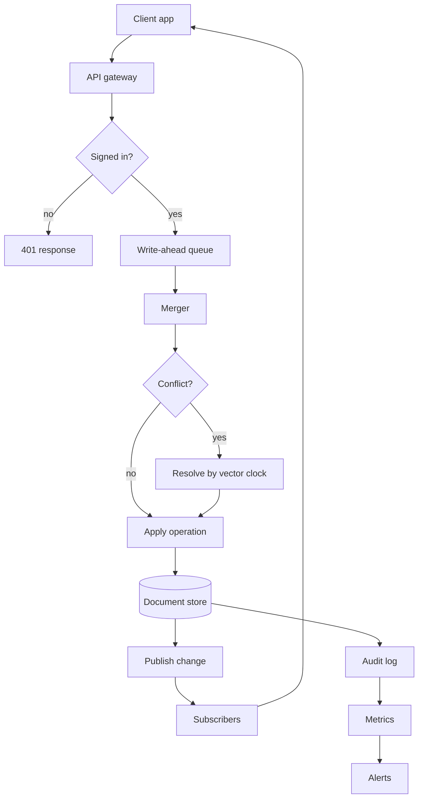
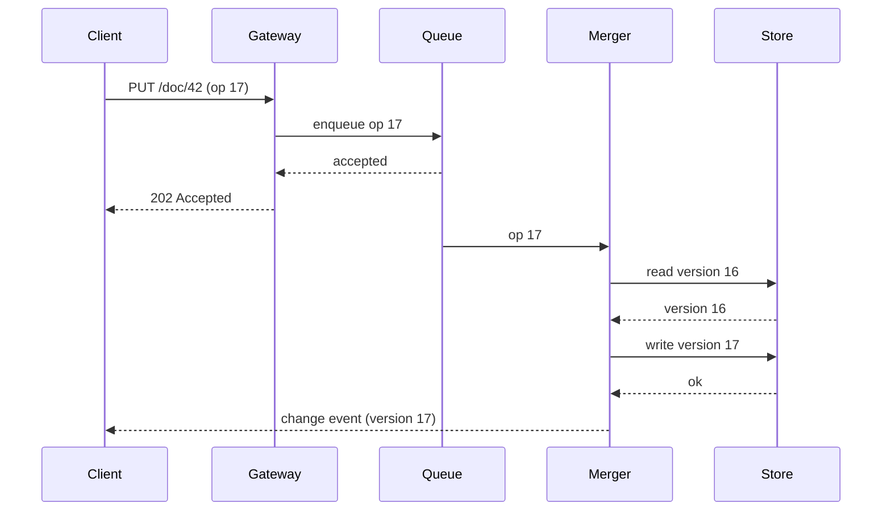
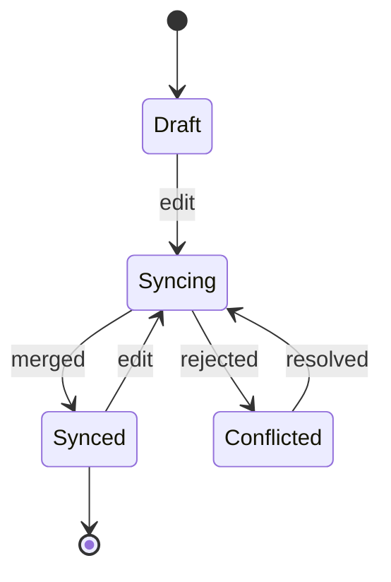
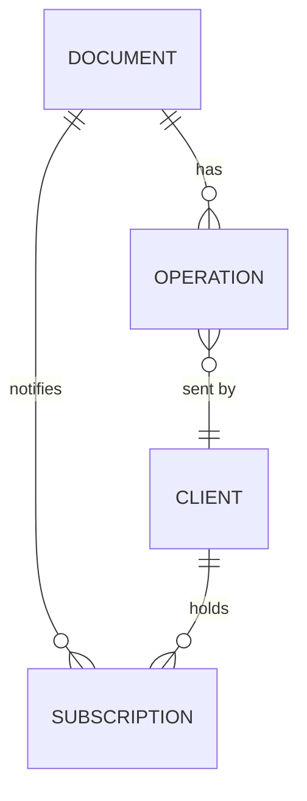
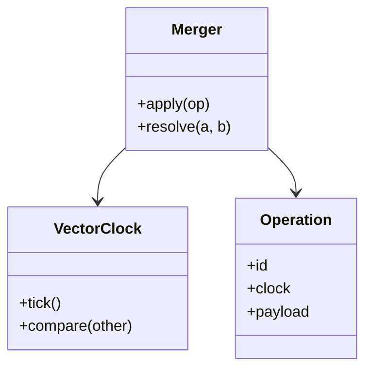
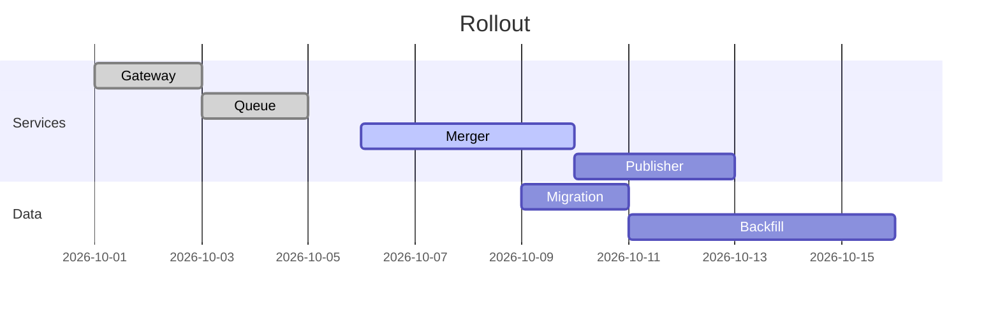
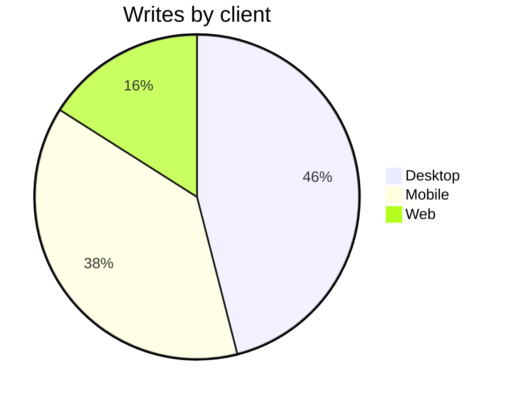
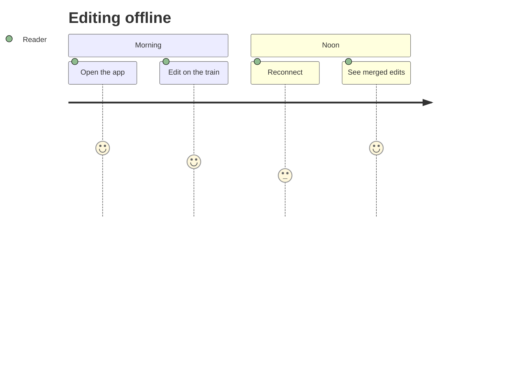
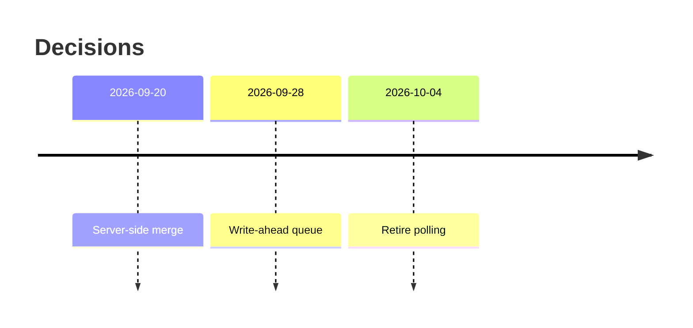

# Release handoff: sync service 2.4

This handoff is what the next person needs to finish the 2.4 release of the sync service: what changed, what is left, what can go wrong, and how to roll back. It is written to be read top to bottom once, then used as a checklist.

> [!IMPORTANT]
> The schema migration in step 3 cannot be undone once the backfill starts. Read the rollback section before you begin.

## Summary

Version 2.4 moves conflict resolution from the client to the server, adds a write-ahead queue for offline edits, and retires the legacy polling endpoint. Two of the four services are deployed; the remaining two wait on the migration described below.

The work is tracked in the [status report](../export/sections.md#risks) and the [timeline](sections.md#timeline).

## Architecture

The request path after this release. Clients write to the queue first; the merger applies operations in order and publishes the result to subscribers. The diagram below is the one to keep in mind while reading the rest of this document, and the one the estimates.



## Sequence of a write



## Document states



## Data model



| Table | Rows today | After backfill | Owner |
|---|---|---|---|
| documents | 1,204,331 | 1,204,331 | storage |
| operations | 88,410,002 | 91,000,000 | sync |
| subscriptions | 3,882,019 | 3,900,000 | sync |
| clients | 402,118 | 402,118 | accounts |

## Classes in the merger



## Rollout plan



The release script:

```bash
#!/usr/bin/env bash
set -euo pipefail
./scripts/check-health.sh --service gateway --service queue
./scripts/migrate.sh --target 2.4 --dry-run
./scripts/migrate.sh --target 2.4
./scripts/backfill.sh --batch 5000 --sleep 200ms
./scripts/deploy.sh merger publisher --canary 5%
./scripts/deploy.sh merger publisher --canary 50%
./scripts/deploy.sh merger publisher --canary 100%
./scripts/check-health.sh --all
```

## Traffic by client



## A reader's day after the release



## Risks

1. **The backfill is slower than estimated.** At 5,000 rows per batch it takes about 5 days; at peak load it may need 8.
2. **Clients older than 2.1 send operations without a clock.** The merger rejects them; those clients see a conflict on every edit.
3. **The legacy polling endpoint still has 2% of traffic.** Retiring it on schedule breaks those clients.

The cost of the backfill, in database hours, is $C = r \cdot n / b$ for $n$ rows, $b$ per batch and $r$ hours per batch.

$$T = \frac{n}{b} \cdot (t_{batch} + t_{sleep})$$

## Rollback

<details>
<summary>Before the backfill starts</summary>

Redeploy 2.3 of the merger and publisher. The queue and gateway are compatible with both versions.

</details>

<details>
<summary>After the backfill starts</summary>

There is no rollback of the schema. Stop the backfill, keep 2.4 deployed, and fix forward.

</details>

## Timeline of decisions



## Next steps

- [x] Deploy gateway and queue
- [ ] Run the migration in the maintenance window
- [ ] Start the backfill and watch the lag dashboard
- [ ] Deploy merger and publisher behind the canary

Questions go to the release channel. The estimate for the backfill comes from the load test[^1].

[^1]: Load test of 2026-10-02, 5,000 rows per batch, 200 ms between batches.
