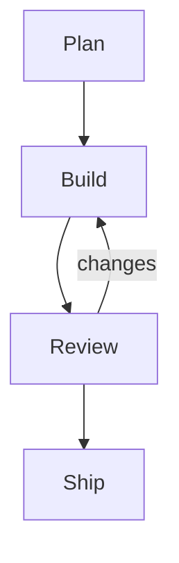
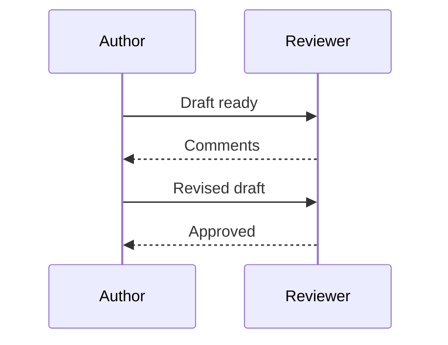

# Release handoff

A long document whose sections are linked to directly. Diagrams near the top are drawn after the first paint and
push everything below them down, which is what a link to a section must survive.



## Status

Paragraph one of the status. Words to read, words to read, words to read, words to read, words to read.

Paragraph two of the status. Words to read, words to read, words to read, words to read, words to read.



## Risks

| Risk | Likelihood | Owner |
|---|---|---|
| Schema drift | Medium | Data |
| Late review | High | Docs |
| Flaky test | Low | QA |

See the [release checklist](https://example.com/releases/checklist) and write to [the release desk](mailto:release@example.com).
The tracker lives at <https://example.com/tracker>.

<details>
<summary>Background</summary>

## Inside the details

This heading sits in a closed details block. A link to it opens the block first.

</details>

## Timeline

Paragraph one of the timeline. Words to read, words to read, words to read, words to read, words to read.

Paragraph two of the timeline. Words to read, words to read, words to read, words to read, words to read.

Paragraph three of the timeline. Words to read, words to read, words to read, words to read, words to read.

## Next steps

1. Merge the branch.
2. Tag the release.
3. Announce it.

The release script:

```sh
git tag --annotate v2.0.0 --message "Release 2.0.0: the export and copy features, with a very long message that runs well past the width of a printed page"
```

Paragraph after the steps. Words to read, words to read, words to read, words to read, words to read.

Paragraph after the steps. Words to read, words to read, words to read, words to read, words to read.

Paragraph after the steps. Words to read, words to read, words to read, words to read, words to read.

Paragraph after the steps. Words to read, words to read, words to read, words to read, words to read.

# Appendix

The second top-level heading starts a new page on paper.
